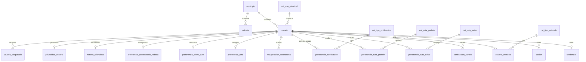
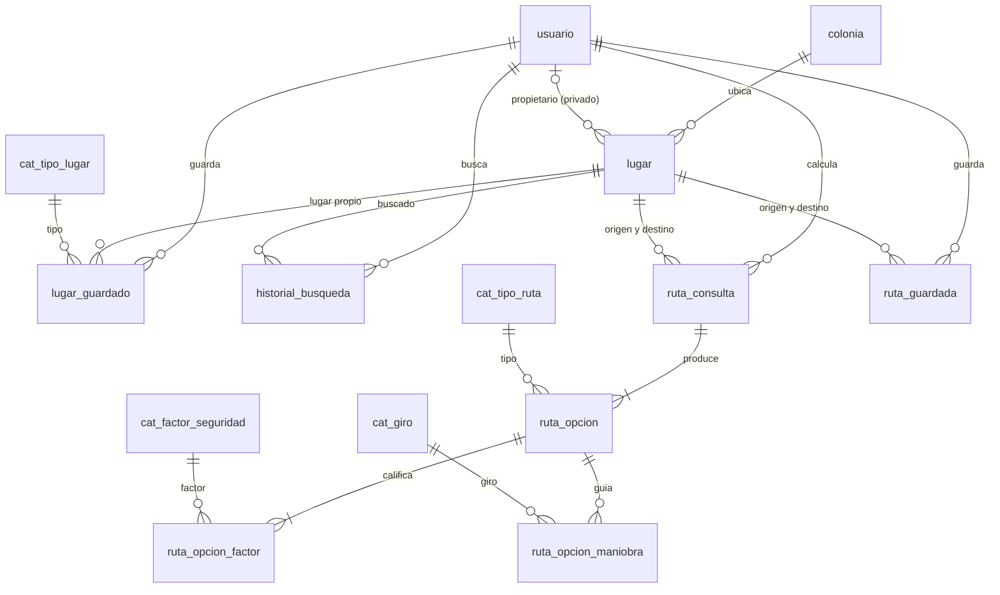
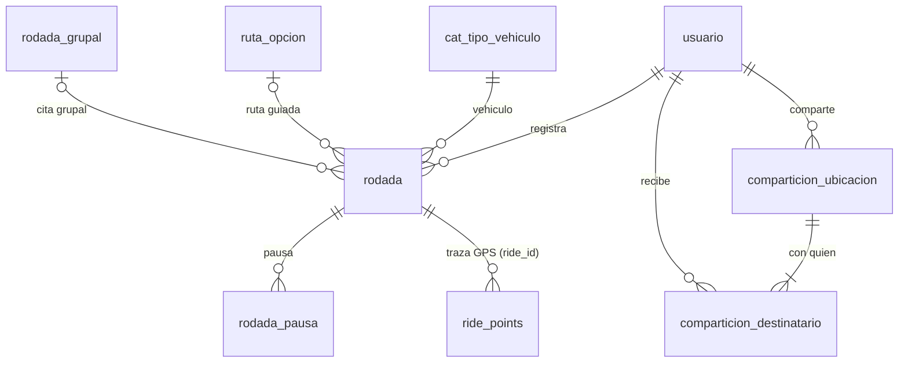
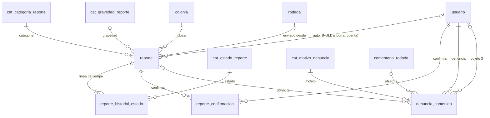
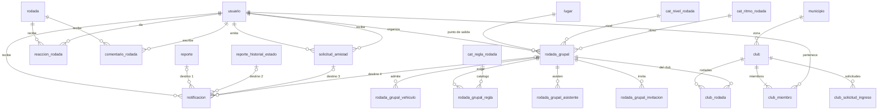
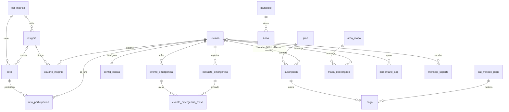

# Base de datos de Waylo

> Estado: diseño e implementación de la sesión A. El SQL se revisó con un analizador sintáctico de PostgreSQL y a mano, pero **no se probó contra una base real** (en la máquina de desarrollo no hay PostgreSQL 16 con PostGIS). Se prueba en la VM con `./db/apply.sh --seed` y `psql -f db/verify.sql` (ver `db/README.md`). Los errores que aparezcan se corrigen en la rama `db-esquema`.

PostgreSQL 16 + PostGIS 3.5.3, base `waylo_db`, esquema `waylo` (nunca `public`), dueño `waylo_user`, rol de la aplicación `waylo_app` (solo DML). Ids `uuid` (`gen_random_uuid()`), fechas `timestamptz` en UTC (se presentan en `America/Monterrey`), nombres en español en `snake_case`. Excepción por contrato con el servicio en tiempo real: la tabla `ride_points` y sus columnas están en inglés.

## 1. Resumen del diseño y decisiones importantes

**Alcance:** 86 tablas, 28 vistas y 3 funciones de consulta, en 16 migraciones numeradas (`db/migrations`) más 6 archivos de datos de demostración (`db/seeds`).

**El requisito principal es 4FN.** Las decisiones que más se notan frente a los mocks (`src/mocks`, desnormalizados a propósito para la interfaz):

1. **Catálogos en tablas** con llave natural (`clave`): categorías de reporte, estados, gravedad, niveles, ritmos, vehículos, factores del Safety Score, tipos de lugar, tipos de notificación, métricas, planes, áreas de mapa, etc. Los conjuntos cerrados sin atributos propios se dejan como `CHECK` (ver §5).
2. **Nada derivado se guarda.** Conteos de confirmaciones, asistentes, participantes, reacciones, notificaciones sin leer, amigos en común, estadísticas por persona y por mes, kilómetros, minutos, velocidad promedio, Safety Score de una ruta o de una rodada, minutos extra, progreso de retos e insignias, score/tendencia/conteos/riesgo horario de zona, IVA y subtotal: todo es vista o función (§6).
3. **Estados deducibles no se guardan.** `rodada` no tiene `estado` (en curso = `finalizada_en IS NULL`); `rodada_grupal` solo guarda `cancelada_en` (programada/finalizada/cancelada se deduce con la fecha); `suscripcion` guarda `vigente_hasta` y `cancelada_en`; `comparticion_ubicacion` guarda `inicia_en`, `expira_en` y `detenida_en`; el estado de un reporte es el último renglón de su historial; el tipo de una notificación se deduce de su destino.
4. **Hechos multivaluados independientes, en tablas separadas (4FN).** Los vehículos de una persona, lo que evita, lo que prefiere, sus preferencias de notificación, sus contactos de emergencia y sus bloqueados son seis tablas distintas, nunca una tabla de producto cruzado. Igual: vehículos, reglas, asistentes e invitaciones de una rodada grupal; miembros y rodadas de un club; evento de emergencia y contactos avisados.
5. **"Ambos" vehículos** del prototipo son dos renglones (relación N:M), no un valor mixto.
6. **Amistad con una sola fuente de verdad:** `solicitud_amistad` (con `respondida_en`, `resultado` y `amistad_terminada_en`). La amistad es la **vista** `v_amistad` = solicitud aceptada y no terminada. Un índice único **parcial** sobre el par no ordenado (`LEAST/GREATEST`) impide dos vínculos vigentes pero no bloquea reintentos tras un rechazo, una cancelación o el fin de una amistad. No existe una tabla `amistad` que pueda contradecir a las solicitudes.
7. **Referencias polimórficas con FK reales:** `notificacion` (exactamente una de cuatro claves de destino) y `denuncia_contenido` (exactamente una de tres), ambas con `CHECK (num_nonnulls(...) = 1)`.
8. **Geografía sin repetir texto:** `municipio → colonia`. No hay tabla de calles: `reporte` y `lugar` guardan una referencia de texto libre (la pantalla la captura así) y la FK a `colonia`; el municipio siempre se obtiene por la colonia.
9. **Lugares privados:** `lugar.propietario_id` NULL = público; si no, privado de esa persona. `lugar_guardado` usa una **FK compuesta** `(lugar_id, usuario_id) → lugar(id, propietario_id)` que obliga a que lo guardado sea del propio usuario, e índice único parcial para **una sola "casa"** por usuario. Otras personas solo consultan `v_lugar_publico`, que nunca incluye lugares privados (la casa jamás sale).
10. **Privacidad:** `privacidad_usuario` con columnas explícitas (visibilidad de rodadas, perfil visible, reportes anónimos). La **autoría de un reporte se guarda siempre** en `reporte.usuario_id`, pero las vistas públicas (`v_reporte_publico`, `fn_reportes_cercanos`) solo exponen `autor_visible_id`, que es NULL si la persona eligió "reportes anónimos". `v_reporte_publico` ni siquiera tiene la columna `usuario_id`. Las vistas de actividad respetan visibilidad, perfil visible y bloqueos.
11. **Borrado de cuenta:** `DELETE FROM usuario` borra en cascada los datos personales (rodadas y su traza, lugares, solicitudes, preferencias, notificaciones...). Los **reportes ya enviados se anonimizan** (`usuario_id` pasa a NULL con `ON DELETE SET NULL`) y las suscripciones y pagos se conservan sin usuario (comprobantes). `verify.sql` lo comprueba.
12. **`ride_points` según el contrato** de `docs/arquitectura.md`: `(ride_id, ts)` como llave primaria, `geog`, `speed`, `heading`, `accuracy`, **sin `user_id`** (el dueño sale de `rodada.usuario_id`); mismos rangos de validación que el servicio, con `CHECK`.
13. **Safety Score de zona** con una fórmula documentada que solo usa reportes dentro del polígono (§6.2), y **métricas calculables** para retos e insignias (`fn_valor_metrica`).
14. **Triggers:** solo `fn_tocar_actualizado_en` en `usuario`, `rodada`, `rodada_grupal`, `reporte` y `club` (mantener `actualizado_en`). Todo lo demás son restricciones declarativas.

## 2. Diagramas entidad-relación (Mermaid)

Se muestran llaves y relaciones; las columnas completas están en el diccionario de datos (§3).

### 2.1 Cuenta y preferencias



### 2.2 Lugares y rutas



### 2.3 Rodadas, traza GPS y ubicación en vivo



### 2.4 Reportes



### 2.5 Social, rodadas grupales y clubes



### 2.6 Retos, insignias, seguridad personal, Premium, zonas y ayuda



## 3. Diccionario de datos

Además de estas tablas existe `waylo.schema_migrations` (version, checksum, aplicada_en), que crea y mantiene `db/apply.sh`.

Generado a partir de las migraciones. `FK → t` lleva la política de borrado. Las columnas con `CHECK` en línea muestran la condición; los `CHECK` de varias columnas y las llaves compuestas se listan bajo cada tabla.

### Catálogos

#### `cat_tipo_vehiculo` — Tipos de vehículo (bicicleta, scooter).

| Columna | Tipo | Restricciones | Descripción |
|---|---|---|---|
| `clave` | `text` | PK | Clave estable del catálogo (llave natural). |
| `nombre` | `text` | NOT NULL; UNIQUE | Nombre para mostrar. |

#### `cat_uso_principal` — Uso principal de la persona.

| Columna | Tipo | Restricciones | Descripción |
|---|---|---|---|
| `clave` | `text` | PK | Clave estable del catálogo (llave natural). |
| `nombre` | `text` | NOT NULL; UNIQUE | Nombre para mostrar. |

#### `cat_nivel_rodada` — Niveles de una rodada grupal.

| Columna | Tipo | Restricciones | Descripción |
|---|---|---|---|
| `clave` | `text` | PK | Clave estable del catálogo (llave natural). |
| `nombre` | `text` | NOT NULL; UNIQUE | Nombre para mostrar. |
| `orden` | `smallint` | NOT NULL; UNIQUE | Orden de presentación. |

#### `cat_ritmo_rodada` — Ritmos de una rodada grupal.

| Columna | Tipo | Restricciones | Descripción |
|---|---|---|---|
| `clave` | `text` | PK | Clave estable del catálogo (llave natural). |
| `nombre` | `text` | NOT NULL; UNIQUE | Nombre para mostrar. |
| `orden` | `smallint` | NOT NULL; UNIQUE | Orden de presentación. |

#### `cat_regla_rodada` — Reglas y recomendaciones de una rodada.

| Columna | Tipo | Restricciones | Descripción |
|---|---|---|---|
| `clave` | `text` | PK | Clave estable del catálogo (llave natural). |
| `nombre` | `text` | NOT NULL; UNIQUE | Nombre para mostrar. |

#### `cat_categoria_reporte` — Categorías de reporte con ícono y peso de riesgo.

| Columna | Tipo | Restricciones | Descripción |
|---|---|---|---|
| `clave` | `text` | PK | Clave estable del catálogo (llave natural). |
| `nombre` | `text` | NOT NULL; UNIQUE | Nombre para mostrar. |
| `icono` | `text` | NOT NULL | Nombre del ícono (lucide-react). |
| `peso_riesgo` | `numeric(4, 2)` | NOT NULL; CHECK peso_riesgo > 0 | Aporte al riesgo de una zona por cada reporte. |

#### `cat_estado_reporte` — Estados de un reporte.

| Columna | Tipo | Restricciones | Descripción |
|---|---|---|---|
| `clave` | `text` | PK | Clave estable del catálogo (llave natural). |
| `nombre` | `text` | NOT NULL; UNIQUE | Nombre para mostrar. |
| `orden` | `smallint` | NOT NULL; UNIQUE | Orden de presentación. |

#### `cat_gravedad_reporte` — Gravedad de un reporte.

| Columna | Tipo | Restricciones | Descripción |
|---|---|---|---|
| `clave` | `text` | PK | Clave estable del catálogo (llave natural). |
| `nombre` | `text` | NOT NULL; UNIQUE | Nombre para mostrar. |
| `orden` | `smallint` | NOT NULL; UNIQUE | Orden de presentación. |

#### `cat_motivo_denuncia` — Motivos de denuncia.

| Columna | Tipo | Restricciones | Descripción |
|---|---|---|---|
| `clave` | `text` | PK | Clave estable del catálogo (llave natural). |
| `nombre` | `text` | NOT NULL; UNIQUE | Nombre para mostrar. |

#### `cat_tipo_ruta` — Tipos de ruta.

| Columna | Tipo | Restricciones | Descripción |
|---|---|---|---|
| `clave` | `text` | PK | Clave estable del catálogo (llave natural). |
| `nombre` | `text` | NOT NULL; UNIQUE | Nombre para mostrar. |
| `orden` | `smallint` | NOT NULL; UNIQUE | Orden de presentación. |

#### `cat_factor_seguridad` — Los 5 factores del Safety Score con su peso.

| Columna | Tipo | Restricciones | Descripción |
|---|---|---|---|
| `clave` | `text` | PK | Clave estable del catálogo (llave natural). |
| `nombre` | `text` | NOT NULL; UNIQUE | Nombre para mostrar. |
| `orden` | `smallint` | NOT NULL; UNIQUE | Orden de presentación. |
| `peso` | `numeric(4, 3)` | NOT NULL; CHECK peso > 0 AND peso <= 1 | Ponderación en el Safety Score (suman 1). |

#### `cat_giro` — Tipos de maniobra de navegación.

| Columna | Tipo | Restricciones | Descripción |
|---|---|---|---|
| `clave` | `text` | PK | Clave estable del catálogo (llave natural). |
| `nombre` | `text` | NOT NULL; UNIQUE | Nombre para mostrar. |

#### `cat_ruta_evitar` — Qué se puede evitar al rutear.

| Columna | Tipo | Restricciones | Descripción |
|---|---|---|---|
| `clave` | `text` | PK | Clave estable del catálogo (llave natural). |
| `nombre` | `text` | NOT NULL; UNIQUE | Nombre para mostrar. |
| `descripcion` | `text` | NOT NULL | Explicación mostrada. |

#### `cat_ruta_preferir` — Qué se puede preferir al rutear.

| Columna | Tipo | Restricciones | Descripción |
|---|---|---|---|
| `clave` | `text` | PK | Clave estable del catálogo (llave natural). |
| `nombre` | `text` | NOT NULL; UNIQUE | Nombre para mostrar. |
| `descripcion` | `text` | NOT NULL | Explicación mostrada. |

#### `cat_tipo_lugar` — Tipos de lugar guardado.

| Columna | Tipo | Restricciones | Descripción |
|---|---|---|---|
| `clave` | `text` | PK | Clave estable del catálogo (llave natural). |
| `nombre` | `text` | NOT NULL; UNIQUE | Nombre para mostrar. |

#### `cat_tipo_notificacion` — Tipos de notificación configurables.

| Columna | Tipo | Restricciones | Descripción |
|---|---|---|---|
| `clave` | `text` | PK | Clave estable del catálogo (llave natural). |
| `nombre` | `text` | NOT NULL; UNIQUE | Nombre para mostrar. |
| `descripcion` | `text` | NOT NULL | Explicación mostrada. |

#### `cat_metrica` — Métricas calculables para retos e insignias.

| Columna | Tipo | Restricciones | Descripción |
|---|---|---|---|
| `clave` | `text` | PK | Clave estable del catálogo (llave natural). |
| `nombre` | `text` | NOT NULL; UNIQUE | Nombre para mostrar. |
| `unidad` | `text` | NOT NULL | Unidad de la métrica. |
| `descripcion` | `text` | NOT NULL | Descripción. |

#### `cat_tipo_evento_emergencia` — Tipos de evento de emergencia.

| Columna | Tipo | Restricciones | Descripción |
|---|---|---|---|
| `clave` | `text` | PK | Clave estable del catálogo (llave natural). |
| `nombre` | `text` | NOT NULL; UNIQUE | Nombre para mostrar. |

#### `cat_metodo_pago` — Métodos de pago.

| Columna | Tipo | Restricciones | Descripción |
|---|---|---|---|
| `clave` | `text` | PK | Clave estable del catálogo (llave natural). |
| `nombre` | `text` | NOT NULL; UNIQUE | Nombre para mostrar. |

#### `cat_tipo_comentario` — Tipos de comentario sobre la app.

| Columna | Tipo | Restricciones | Descripción |
|---|---|---|---|
| `clave` | `text` | PK | Clave estable del catálogo (llave natural). |
| `nombre` | `text` | NOT NULL; UNIQUE | Nombre para mostrar. |

#### `cat_tema_soporte` — Temas de soporte.

| Columna | Tipo | Restricciones | Descripción |
|---|---|---|---|
| `clave` | `text` | PK | Clave estable del catálogo (llave natural). |
| `nombre` | `text` | NOT NULL; UNIQUE | Nombre para mostrar. |

#### `cat_franja_horaria` — Franjas horarias del riesgo por hora.

| Columna | Tipo | Restricciones | Descripción |
|---|---|---|---|
| `clave` | `text` | PK | Clave estable del catálogo (llave natural). |
| `etiqueta` | `text` | NOT NULL; UNIQUE | Texto de la franja. |
| `hora_desde` | `smallint` | NOT NULL; UNIQUE; CHECK hora_desde BETWEEN 0 AND 23 | Hora inicial (incluida). |
| `hora_hasta` | `smallint` | NOT NULL; CHECK hora_hasta BETWEEN 1 AND 24 | Hora final (excluida). |

Restricciones de tabla: `CHECK hora_hasta > hora_desde`.

### Geografía

#### `municipio`

| Columna | Tipo | Restricciones | Descripción |
|---|---|---|---|
| `clave` | `text` | PK | Clave (slug) del municipio. |
| `nombre` | `text` | NOT NULL; UNIQUE | Nombre oficial. |

#### `colonia`

| Columna | Tipo | Restricciones | Descripción |
|---|---|---|---|
| `id` | `uuid` | PK; DEFAULT gen_random_uuid() | Identificador. |
| `municipio_clave` | `text` | NOT NULL; FK → municipio (RESTRICT) | Municipio al que pertenece. |
| `nombre` | `text` | NOT NULL; CHECK btrim(nombre) <> '' | Nombre de la colonia. |

Restricciones de tabla: `UNIQUE (municipio_clave, nombre)`.

### Cuenta

#### `usuario` — Cuenta y perfil.

| Columna | Tipo | Restricciones | Descripción |
|---|---|---|---|
| `id` | `uuid` | PK; DEFAULT gen_random_uuid() | Identificador (uuid). |
| `nombre` | `text` | NOT NULL; CHECK btrim(nombre) <> '' | Nombre completo. |
| `correo` | `text` | NOT NULL; CHECK correo = lower(btrim(correo)) AND correo LIKE '%_@_%' | Correo en minúsculas; único. |
| `ocupacion` | `text` |  | Ocupación (texto libre, opcional). |
| `municipio_clave` | `text` | FK → municipio (RESTRICT) | Municipio de residencia. |
| `uso_principal_clave` | `text` | NOT NULL; DEFAULT 'transporte'; FK → cat_uso_principal (RESTRICT) | Uso principal: transporte o recreativo. |
| `bio` | `text` |  | Biografía. |
| `creado_en` | `timestamptz` | NOT NULL; DEFAULT now() | Alta en Waylo ("miembro desde"). |
| `actualizado_en` | `timestamptz` | NOT NULL; DEFAULT now() | Última modificación (la mantiene el trigger fn_tocar_actualizado_en). |

#### `credencial`

| Columna | Tipo | Restricciones | Descripción |
|---|---|---|---|
| `usuario_id` | `uuid` | PK; FK → usuario (CASCADE) | Persona dueña del registro. |
| `contrasena_hash` | `text` | NOT NULL | Hash de la contraseña. |
| `cambiada_en` | `timestamptz` | NOT NULL; DEFAULT now() | Último cambio de contraseña. |

#### `sesion`

| Columna | Tipo | Restricciones | Descripción |
|---|---|---|---|
| `id` | `uuid` | PK; DEFAULT gen_random_uuid() | Identificador (uuid). |
| `usuario_id` | `uuid` | NOT NULL; FK → usuario (CASCADE) | Persona dueña del registro. |
| `token_hash` | `text` | NOT NULL; UNIQUE | Hash del token (nunca el token). |
| `creada_en` | `timestamptz` | NOT NULL; DEFAULT now() | Inicio de sesión. |
| `expira_en` | `timestamptz` | NOT NULL | Vencimiento. |
| `revocada_en` | `timestamptz` |  | Cierre de sesión; NULL = vigente. |

Restricciones de tabla: `CHECK expira_en > creada_en`.

#### `verificacion_correo`

| Columna | Tipo | Restricciones | Descripción |
|---|---|---|---|
| `id` | `uuid` | PK; DEFAULT gen_random_uuid() | Identificador (uuid). |
| `usuario_id` | `uuid` | NOT NULL; FK → usuario (CASCADE) | Persona dueña del registro. |
| `correo` | `text` | NOT NULL | Correo que se verifica (puede cambiar con el tiempo). |
| `codigo_hash` | `text` | NOT NULL | Hash del código enviado. |
| `creado_en` | `timestamptz` | NOT NULL; DEFAULT now() | Fecha de creación (UTC). |
| `expira_en` | `timestamptz` | NOT NULL | Vencimiento. |
| `confirmada_en` | `timestamptz` |  | Momento de confirmación; NULL = sin confirmar. |

Restricciones de tabla: `CHECK expira_en > creado_en`.

#### `recuperacion_contrasena`

| Columna | Tipo | Restricciones | Descripción |
|---|---|---|---|
| `id` | `uuid` | PK; DEFAULT gen_random_uuid() | Identificador (uuid). |
| `usuario_id` | `uuid` | NOT NULL; FK → usuario (CASCADE) | Persona dueña del registro. |
| `token_hash` | `text` | NOT NULL; UNIQUE | Hash del token (nunca el token). |
| `creada_en` | `timestamptz` | NOT NULL; DEFAULT now() | Fecha de creación (UTC). |
| `expira_en` | `timestamptz` | NOT NULL | Vencimiento. |
| `usada_en` | `timestamptz` |  | Momento de uso del enlace; NULL = sin usar. |

Restricciones de tabla: `CHECK expira_en > creada_en`.

#### `usuario_vehiculo`

| Columna | Tipo | Restricciones | Descripción |
|---|---|---|---|
| `usuario_id` | `uuid` | NOT NULL; FK → usuario (CASCADE) | Persona dueña del registro. |
| `tipo_vehiculo_clave` | `text` | NOT NULL; FK → cat_tipo_vehiculo (RESTRICT) | Vehículo que usa la persona. |

Restricciones de tabla: `PRIMARY KEY (usuario_id, tipo_vehiculo_clave)`.

#### `preferencia_ruta`

| Columna | Tipo | Restricciones | Descripción |
|---|---|---|---|
| `usuario_id` | `uuid` | PK; FK → usuario (CASCADE) | Persona dueña del registro. |
| `inclinacion_segura` | `smallint` | NOT NULL; DEFAULT 50; CHECK inclinacion_segura BETWEEN 0 AND 100 | 0 = prioriza la ruta más rápida, 100 = la más segura. |
| `minutos_extra_max` | `smallint` | NOT NULL; DEFAULT 10; CHECK minutos_extra_max BETWEEN 0 AND 60 | Minutos extra que acepta para una ruta más segura. |

#### `preferencia_ruta_evitar`

| Columna | Tipo | Restricciones | Descripción |
|---|---|---|---|
| `usuario_id` | `uuid` | NOT NULL; FK → usuario (CASCADE) | Persona dueña del registro. |
| `evitar_clave` | `text` | NOT NULL; FK → cat_ruta_evitar (RESTRICT) | Qué evitar al rutear. |

Restricciones de tabla: `PRIMARY KEY (usuario_id, evitar_clave)`.

#### `preferencia_ruta_preferir`

| Columna | Tipo | Restricciones | Descripción |
|---|---|---|---|
| `usuario_id` | `uuid` | NOT NULL; FK → usuario (CASCADE) | Persona dueña del registro. |
| `preferir_clave` | `text` | NOT NULL; FK → cat_ruta_preferir (RESTRICT) | Qué preferir al rutear. |

Restricciones de tabla: `PRIMARY KEY (usuario_id, preferir_clave)`.

#### `preferencia_notificacion`

| Columna | Tipo | Restricciones | Descripción |
|---|---|---|---|
| `usuario_id` | `uuid` | NOT NULL; FK → usuario (CASCADE) | Persona dueña del registro. |
| `tipo_clave` | `text` | NOT NULL; FK → cat_tipo_notificacion (RESTRICT) | Tipo de notificación configurable. |
| `activa` | `boolean` | NOT NULL | Si la persona quiere recibir este tipo. |

Restricciones de tabla: `PRIMARY KEY (usuario_id, tipo_clave)`.

#### `preferencia_alerta_ruta`

| Columna | Tipo | Restricciones | Descripción |
|---|---|---|---|
| `usuario_id` | `uuid` | PK; FK → usuario (CASCADE) | Persona dueña del registro. |
| `distancia_aviso_m` | `smallint` | NOT NULL; DEFAULT 500; CHECK distancia_aviso_m IN (200, 500, 1000) | Distancia de aviso de alertas: 200, 500 o 1000 m. |

#### `preferencia_recordatorio_rodada`

| Columna | Tipo | Restricciones | Descripción |
|---|---|---|---|
| `usuario_id` | `uuid` | PK; FK → usuario (CASCADE) | Persona dueña del registro. |
| `anticipacion_min` | `integer` | NOT NULL; DEFAULT 60; CHECK anticipacion_min IN (60, 1440) | Anticipación del recordatorio: 60 (1 h) o 1440 (1 día) min. |

#### `horario_silencioso`

| Columna | Tipo | Restricciones | Descripción |
|---|---|---|---|
| `usuario_id` | `uuid` | PK; FK → usuario (CASCADE) | Persona dueña del registro. |
| `desde` | `time` | NOT NULL; DEFAULT '22:00' | Inicio de "No molestar". |
| `hasta` | `time` | NOT NULL; DEFAULT '06:30' | Fin de "No molestar". |

Restricciones de tabla: `CHECK desde <> hasta`.

#### `privacidad_usuario`

| Columna | Tipo | Restricciones | Descripción |
|---|---|---|---|
| `usuario_id` | `uuid` | PK; FK → usuario (CASCADE) | Persona dueña del registro. |
| `visibilidad_rodadas` | `text` | NOT NULL; DEFAULT 'amigos'; CHECK visibilidad_rodadas IN ('todos', 'amigos', 'yo') | Quién ve sus rodadas: todos, amigos o yo. |
| `perfil_visible` | `boolean` | NOT NULL; DEFAULT TRUE | Si otras personas pueden encontrarla en la búsqueda. |
| `reportes_anonimos` | `boolean` | NOT NULL; DEFAULT FALSE | Si oculta su autoría en reportes públicos (la autoría se guarda igual). |

#### `usuario_bloqueado`

| Columna | Tipo | Restricciones | Descripción |
|---|---|---|---|
| `usuario_id` | `uuid` | NOT NULL; FK → usuario (CASCADE) | Persona dueña del registro. |
| `bloqueado_id` | `uuid` | NOT NULL; FK → usuario (CASCADE) | Persona bloqueada. |
| `bloqueado_en` | `timestamptz` | NOT NULL; DEFAULT now() | Momento del bloqueo. |

Restricciones de tabla: `PRIMARY KEY (usuario_id, bloqueado_id)`; `CHECK usuario_id <> bloqueado_id`.

### Lugares y rutas

#### `lugar` — Punto con nombre; público o privado de una persona.

| Columna | Tipo | Restricciones | Descripción |
|---|---|---|---|
| `id` | `uuid` | PK; DEFAULT gen_random_uuid() | Identificador (uuid). |
| `nombre` | `text` | NOT NULL; CHECK btrim(nombre) <> '' | Nombre para mostrar. |
| `detalle` | `text` |  | Calle o referencia en texto libre. |
| `geog` | `geography(point, 4326)` | NOT NULL | Ubicación (geography Point, SRID 4326). |
| `colonia_id` | `uuid` | FK → colonia (SET NULL) | Colonia (de ahí se obtiene el municipio). |
| `propietario_id` | `uuid` | FK → usuario (CASCADE) | NULL = lugar público; si no, lugar privado de esa persona. |
| `creado_en` | `timestamptz` | NOT NULL; DEFAULT now() | Fecha de creación (UTC). |

Restricciones de tabla: `UNIQUE (id, propietario_id)`; `CHECK st_y(CAST(geog AS geometry)) BETWEEN 25.4 AND 26.0 AND st_x(CAST(geog AS geometry)) BETWEEN -100.7 AND -100.0`.

#### `lugar_guardado`

| Columna | Tipo | Restricciones | Descripción |
|---|---|---|---|
| `id` | `uuid` | PK; DEFAULT gen_random_uuid() | Identificador (uuid). |
| `usuario_id` | `uuid` | NOT NULL; FK → usuario (CASCADE) | Persona dueña del registro. |
| `lugar_id` | `uuid` | NOT NULL | Lugar privado de la persona (FK compuesta con usuario_id). |
| `tipo_lugar_clave` | `text` | NOT NULL; FK → cat_tipo_lugar (RESTRICT) | Casa, escuela, trabajo o favorito. |
| `etiqueta` | `text` | NOT NULL; CHECK btrim(etiqueta) <> '' | Nombre que le pone la persona. |
| `creado_en` | `timestamptz` | NOT NULL; DEFAULT now() | Fecha de creación (UTC). |

Restricciones de tabla: `UNIQUE (usuario_id, lugar_id)`; `FOREIGN KEY (lugar_id,usuario_id) -> lugar(id,propietario_id)`.

#### `historial_busqueda`

| Columna | Tipo | Restricciones | Descripción |
|---|---|---|---|
| `id` | `uuid` | PK; DEFAULT gen_random_uuid() | Identificador (uuid). |
| `usuario_id` | `uuid` | NOT NULL; FK → usuario (CASCADE) | Persona dueña del registro. |
| `lugar_id` | `uuid` | NOT NULL; FK → lugar (CASCADE) | Lugar buscado. |
| `buscado_en` | `timestamptz` | NOT NULL; DEFAULT now() | Última vez que se buscó. |

Restricciones de tabla: `UNIQUE (usuario_id, lugar_id)`.

#### `ruta_consulta`

| Columna | Tipo | Restricciones | Descripción |
|---|---|---|---|
| `id` | `uuid` | PK; DEFAULT gen_random_uuid() | Identificador (uuid). |
| `usuario_id` | `uuid` | NOT NULL; FK → usuario (CASCADE) | Persona dueña del registro. |
| `origen_lugar_id` | `uuid` | NOT NULL; FK → lugar (NO ACTION) | Origen. |
| `destino_lugar_id` | `uuid` | NOT NULL; FK → lugar (NO ACTION) | Destino. |
| `calculada_en` | `timestamptz` | NOT NULL; DEFAULT now() | Momento del cálculo. |

Restricciones de tabla: `CHECK origen_lugar_id <> destino_lugar_id`.

#### `ruta_opcion`

| Columna | Tipo | Restricciones | Descripción |
|---|---|---|---|
| `id` | `uuid` | PK; DEFAULT gen_random_uuid() | Identificador (uuid). |
| `consulta_id` | `uuid` | NOT NULL; FK → ruta_consulta (CASCADE) | Consulta de ruta a la que pertenece. |
| `tipo_ruta_clave` | `text` | NOT NULL; FK → cat_tipo_ruta (RESTRICT) | Rápida, equilibrada o segura. |
| `minutos` | `smallint` | NOT NULL; CHECK minutos > 0 | Duración estimada. |
| `via` | `text` | NOT NULL | Descripción de por dónde va. |
| `resumen` | `text` | NOT NULL | Explicación breve de la opción. |
| `trazo` | `geography(linestring, 4326)` | NOT NULL | Trazo (geography LineString). |

Restricciones de tabla: `UNIQUE (consulta_id, tipo_ruta_clave)`.

#### `ruta_opcion_factor`

| Columna | Tipo | Restricciones | Descripción |
|---|---|---|---|
| `opcion_id` | `uuid` | NOT NULL; FK → ruta_opcion (CASCADE) | Opción de ruta. |
| `factor_clave` | `text` | NOT NULL; FK → cat_factor_seguridad (RESTRICT) | Factor del Safety Score. |
| `calificacion` | `smallint` | NOT NULL; CHECK calificacion BETWEEN 0 AND 100 | 0-100, mayor es mejor. |
| `explicacion` | `text` | NOT NULL | Por qué recibió esa calificación. |

Restricciones de tabla: `PRIMARY KEY (opcion_id, factor_clave)`.

#### `ruta_opcion_maniobra`

| Columna | Tipo | Restricciones | Descripción |
|---|---|---|---|
| `opcion_id` | `uuid` | NOT NULL; FK → ruta_opcion (CASCADE) | Opción de ruta. |
| `orden` | `smallint` | NOT NULL; CHECK orden >= 1 | Posición de la maniobra en la ruta. |
| `giro_clave` | `text` | NOT NULL; FK → cat_giro (RESTRICT) | Tipo de maniobra. |
| `texto` | `text` | NOT NULL | Indicación mostrada. |
| `punto` | `geography(point, 4326)` | NOT NULL | Dónde ocurre. |

Restricciones de tabla: `PRIMARY KEY (opcion_id, orden)`.

#### `ruta_guardada`

| Columna | Tipo | Restricciones | Descripción |
|---|---|---|---|
| `id` | `uuid` | PK; DEFAULT gen_random_uuid() | Identificador (uuid). |
| `usuario_id` | `uuid` | NOT NULL; FK → usuario (CASCADE) | Persona dueña del registro. |
| `nombre` | `text` | NOT NULL; CHECK btrim(nombre) <> '' | Nombre que le pone la persona. |
| `origen_lugar_id` | `uuid` | NOT NULL; FK → lugar (NO ACTION) | Origen. |
| `destino_lugar_id` | `uuid` | NOT NULL; FK → lugar (NO ACTION) | Destino. |
| `tipo_ruta_clave` | `text` | NOT NULL; FK → cat_tipo_ruta (RESTRICT) | Tipo de ruta preferido. |
| `creada_en` | `timestamptz` | NOT NULL; DEFAULT now() | Fecha de creación (UTC). |

Restricciones de tabla: `UNIQUE (usuario_id, nombre)`; `CHECK origen_lugar_id <> destino_lugar_id`.

### Rodadas grupales

#### `rodada_grupal` — Cita grupal con hora y punto de salida.

| Columna | Tipo | Restricciones | Descripción |
|---|---|---|---|
| `id` | `uuid` | PK; DEFAULT gen_random_uuid() | Identificador (uuid). |
| `organizador_id` | `uuid` | NOT NULL; FK → usuario (CASCADE) | Persona que la organiza. |
| `titulo` | `text` | NOT NULL; CHECK btrim(titulo) <> '' | Título. |
| `descripcion` | `text` | NOT NULL; DEFAULT '' | Descripción. |
| `programada_en` | `timestamptz` | NOT NULL | Fecha y hora de salida. |
| `lugar_salida_id` | `uuid` | NOT NULL; FK → lugar (NO ACTION) | Punto de salida. |
| `nivel_clave` | `text` | NOT NULL; FK → cat_nivel_rodada (RESTRICT) | Nivel. |
| `ritmo_clave` | `text` | NOT NULL; FK → cat_ritmo_rodada (RESTRICT) | Ritmo. |
| `distancia_km` | `numeric(5, 1)` | NOT NULL; CHECK distancia_km > 0 | Distancia planeada (dato de la convocatoria, no derivado). |
| `cupo` | `smallint` | CHECK cupo IS NULL OR cupo > 0 | Cupo máximo; NULL = sin límite. |
| `privacidad` | `text` | NOT NULL; DEFAULT 'publica'; CHECK privacidad IN ('publica', 'amigos') | publica o amigos. |
| `cancelada_en` | `timestamptz` |  | Momento de cancelación; NULL = vigente. |
| `creada_en` | `timestamptz` | NOT NULL; DEFAULT now() | Momento de creación. |
| `actualizado_en` | `timestamptz` | NOT NULL; DEFAULT now() | Última modificación (la mantiene el trigger fn_tocar_actualizado_en). |

#### `rodada_grupal_vehiculo`

| Columna | Tipo | Restricciones | Descripción |
|---|---|---|---|
| `rodada_grupal_id` | `uuid` | NOT NULL; FK → rodada_grupal (CASCADE) | Referencia a `rodada_grupal`. |
| `tipo_vehiculo_clave` | `text` | NOT NULL; FK → cat_tipo_vehiculo (RESTRICT) | Vehículo permitido. |

Restricciones de tabla: `PRIMARY KEY (rodada_grupal_id, tipo_vehiculo_clave)`.

#### `rodada_grupal_regla`

| Columna | Tipo | Restricciones | Descripción |
|---|---|---|---|
| `rodada_grupal_id` | `uuid` | NOT NULL; FK → rodada_grupal (CASCADE) | Referencia a `rodada_grupal`. |
| `regla_clave` | `text` | NOT NULL; FK → cat_regla_rodada (RESTRICT) | Regla o recomendación. |

Restricciones de tabla: `PRIMARY KEY (rodada_grupal_id, regla_clave)`.

#### `rodada_grupal_asistente`

| Columna | Tipo | Restricciones | Descripción |
|---|---|---|---|
| `rodada_grupal_id` | `uuid` | NOT NULL; FK → rodada_grupal (CASCADE) | Rodada grupal. |
| `usuario_id` | `uuid` | NOT NULL; FK → usuario (CASCADE) | Persona dueña del registro. |
| `se_unio_en` | `timestamptz` | NOT NULL; DEFAULT now() | Momento en que se unió. |

Restricciones de tabla: `PRIMARY KEY (rodada_grupal_id, usuario_id)`.

#### `rodada_grupal_invitacion`

| Columna | Tipo | Restricciones | Descripción |
|---|---|---|---|
| `rodada_grupal_id` | `uuid` | NOT NULL; FK → rodada_grupal (CASCADE) | Rodada grupal. |
| `invitado_id` | `uuid` | NOT NULL; FK → usuario (CASCADE) | Persona invitada. |
| `invitada_en` | `timestamptz` | NOT NULL; DEFAULT now() | Momento de la invitación. |
| `respondida_en` | `timestamptz` |  | Momento de respuesta; NULL = pendiente. |
| `resultado` | `text` | CHECK resultado IN ('aceptada', 'rechazada') | aceptada o rechazada; NULL = sin responder. |

Restricciones de tabla: `PRIMARY KEY (rodada_grupal_id, invitado_id)`; `CHECK (respondida_en IS NULL) = (resultado IS NULL)`.

### Rodadas individuales y tiempo real

#### `rodada` — Rodada individual registrada por una persona.

| Columna | Tipo | Restricciones | Descripción |
|---|---|---|---|
| `id` | `uuid` | PK; DEFAULT gen_random_uuid() | Identificador (uuid). |
| `usuario_id` | `uuid` | NOT NULL; FK → usuario (CASCADE) | Persona dueña del registro. |
| `titulo` | `text` | NOT NULL; CHECK btrim(titulo) <> '' | Nombre editable de la rodada. |
| `vehiculo_clave` | `text` | NOT NULL; FK → cat_tipo_vehiculo (RESTRICT) | Vehículo usado. |
| `ruta_opcion_id` | `uuid` | FK → ruta_opcion (SET NULL) | Ruta guiada que siguió (opcional). |
| `rodada_grupal_id` | `uuid` | FK → rodada_grupal (SET NULL) | Rodada grupal a la que corresponde (opcional). |
| `iniciada_en` | `timestamptz` | NOT NULL; DEFAULT now() | Inicio. |
| `finalizada_en` | `timestamptz` |  | Fin; NULL = en curso. |
| `eliminada_en` | `timestamptz` |  | Borrado lógico; NULL = visible. |
| `actualizado_en` | `timestamptz` | NOT NULL; DEFAULT now() | Última modificación (la mantiene el trigger fn_tocar_actualizado_en). |

Restricciones de tabla: `CHECK finalizada_en IS NULL OR finalizada_en > iniciada_en`.

#### `rodada_pausa`

| Columna | Tipo | Restricciones | Descripción |
|---|---|---|---|
| `id` | `uuid` | PK; DEFAULT gen_random_uuid() | Identificador (uuid). |
| `rodada_id` | `uuid` | NOT NULL; FK → rodada (CASCADE) | Rodada. |
| `pausada_en` | `timestamptz` | NOT NULL | Inicio de la pausa. |
| `reanudada_en` | `timestamptz` |  | Fin de la pausa; NULL = pausada. |

Restricciones de tabla: `UNIQUE (rodada_id, pausada_en)`; `CHECK reanudada_en IS NULL OR reanudada_en > pausada_en`.

#### `ride_points` — Historial GPS de una rodada; lo escribe el servicio Flask.

| Columna | Tipo | Restricciones | Descripción |
|---|---|---|---|
| `ride_id` | `uuid` | NOT NULL; FK → rodada (CASCADE) | Rodada a la que pertenece el punto (el dueño sale de rodada.usuario_id). |
| `ts` | `timestamptz` | NOT NULL | Marca de tiempo de la lectura GPS. |
| `geog` | `geography(point, 4326)` | NOT NULL | Ubicación (geography Point, SRID 4326). |
| `speed` | `real` | NOT NULL; CHECK speed BETWEEN 0 AND 80 | Velocidad en km/h (0-80). |
| `heading` | `smallint` | NOT NULL; CHECK heading BETWEEN 0 AND 359 | Rumbo 0-359. |
| `accuracy` | `real` | NOT NULL; CHECK accuracy >= 0 AND accuracy <= 30 | Precisión en metros (≤ 30). |

Restricciones de tabla: `PRIMARY KEY (ride_id, ts)`; `CHECK st_y(CAST(geog AS geometry)) BETWEEN 25.4 AND 26.0 AND st_x(CAST(geog AS geometry)) BETWEEN -100.7 AND -100.0`.

#### `comparticion_ubicacion`

| Columna | Tipo | Restricciones | Descripción |
|---|---|---|---|
| `id` | `uuid` | PK; DEFAULT gen_random_uuid() | Identificador (uuid). |
| `usuario_id` | `uuid` | NOT NULL; FK → usuario (CASCADE) | Persona dueña del registro. |
| `inicia_en` | `timestamptz` | NOT NULL; DEFAULT now() | Inicio de la compartición. |
| `expira_en` | `timestamptz` |  | Vencimiento; NULL = hasta que se detenga. |
| `detenida_en` | `timestamptz` |  | Momento en que se detuvo; NULL = no detenida. |

Restricciones de tabla: `CHECK expira_en IS NULL OR expira_en > inicia_en`; `CHECK detenida_en IS NULL OR detenida_en >= inicia_en`.

#### `comparticion_destinatario`

| Columna | Tipo | Restricciones | Descripción |
|---|---|---|---|
| `comparticion_id` | `uuid` | NOT NULL; FK → comparticion_ubicacion (CASCADE) | Compartición. |
| `destinatario_id` | `uuid` | NOT NULL; FK → usuario (CASCADE) | Persona que puede ver la ubicación. |

Restricciones de tabla: `PRIMARY KEY (comparticion_id, destinatario_id)`.

### Reportes

#### `reporte` — Reporte de una incidencia en la vía.

| Columna | Tipo | Restricciones | Descripción |
|---|---|---|---|
| `id` | `uuid` | PK; DEFAULT gen_random_uuid() | Identificador (uuid). |
| `usuario_id` | `uuid` | FK → usuario (SET NULL) | Autor; NULL si la cuenta se borró (reporte anonimizado). |
| `categoria_clave` | `text` | NOT NULL; FK → cat_categoria_reporte (RESTRICT) | Categoría del reporte. |
| `geog` | `geography(point, 4326)` | NOT NULL | Ubicación (geography Point, SRID 4326). |
| `colonia_id` | `uuid` | FK → colonia (SET NULL) | Colonia. |
| `referencia` | `text` |  | Calle o referencia en texto libre. |
| `gravedad_clave` | `text` | FK → cat_gravedad_reporte (RESTRICT) | Gravedad; NULL = reporte pendiente por completar. |
| `nota` | `text` |  | Nota de la persona. |
| `foto_url` | `text` |  | Foto adjunta (URL). |
| `rodada_id` | `uuid` | FK → rodada (SET NULL) | Rodada desde la que se envió (opcional). |
| `creado_en` | `timestamptz` | NOT NULL; DEFAULT now() | Fecha de creación (UTC). |
| `cancelado_en` | `timestamptz` |  | Momento de cancelación; NULL = vigente. |
| `actualizado_en` | `timestamptz` | NOT NULL; DEFAULT now() | Última modificación (la mantiene el trigger fn_tocar_actualizado_en). |

Restricciones de tabla: `CHECK cancelado_en IS NULL OR cancelado_en >= creado_en`; `CHECK st_y(CAST(geog AS geometry)) BETWEEN 25.4 AND 26.0 AND st_x(CAST(geog AS geometry)) BETWEEN -100.7 AND -100.0`.

#### `reporte_historial_estado`

| Columna | Tipo | Restricciones | Descripción |
|---|---|---|---|
| `id` | `uuid` | PK; DEFAULT gen_random_uuid() | Identificador (uuid). |
| `reporte_id` | `uuid` | NOT NULL; FK → reporte (CASCADE) | Reporte. |
| `estado_clave` | `text` | NOT NULL; FK → cat_estado_reporte (RESTRICT) | Estado alcanzado. |
| `registrado_en` | `timestamptz` | NOT NULL; DEFAULT now() | Cuándo. |
| `texto` | `text` |  | Mensaje del municipio. |

Restricciones de tabla: `UNIQUE (reporte_id, estado_clave)`.

#### `reporte_confirmacion`

| Columna | Tipo | Restricciones | Descripción |
|---|---|---|---|
| `reporte_id` | `uuid` | NOT NULL; FK → reporte (CASCADE) | Reporte confirmado. |
| `usuario_id` | `uuid` | NOT NULL; FK → usuario (CASCADE) | Persona dueña del registro. |
| `resultado` | `text` | NOT NULL; CHECK resultado IN ('sigue', 'resuelto') | sigue ("Sigue ahí") o resuelto ("Ya no está"). |
| `confirmado_en` | `timestamptz` | NOT NULL; DEFAULT now() | Cuándo. |

Restricciones de tabla: `PRIMARY KEY (reporte_id, usuario_id)`.

### Social

#### `solicitud_amistad` — Solicitud y, si se acepta, amistad (única fuente).

| Columna | Tipo | Restricciones | Descripción |
|---|---|---|---|
| `id` | `uuid` | PK; DEFAULT gen_random_uuid() | Identificador (uuid). |
| `emisor_id` | `uuid` | NOT NULL; FK → usuario (CASCADE) | Quien envía. |
| `receptor_id` | `uuid` | NOT NULL; FK → usuario (CASCADE) | Quien recibe. |
| `enviada_en` | `timestamptz` | NOT NULL; DEFAULT now() | Envío. |
| `respondida_en` | `timestamptz` |  | Momento de respuesta; NULL = pendiente. |
| `resultado` | `text` | CHECK resultado IN ('aceptada', 'rechazada', 'cancelada') | aceptada, rechazada o cancelada; NULL = pendiente. |
| `amistad_terminada_en` | `timestamptz` |  | Fin de la amistad (solo si fue aceptada); NULL = vigente. |

Restricciones de tabla: `CHECK emisor_id <> receptor_id`; `CHECK (respondida_en IS NULL) = (resultado IS NULL)`; `CHECK respondida_en IS NULL OR respondida_en >= enviada_en`; `CHECK amistad_terminada_en IS NULL OR (COALESCE(resultado, '') = 'aceptada' AND amistad_terminada_en >= respondida_en)`.

#### `reaccion_rodada`

| Columna | Tipo | Restricciones | Descripción |
|---|---|---|---|
| `rodada_id` | `uuid` | NOT NULL; FK → rodada (CASCADE) | Rodada reaccionada. |
| `usuario_id` | `uuid` | NOT NULL; FK → usuario (CASCADE) | Persona dueña del registro. |
| `creada_en` | `timestamptz` | NOT NULL; DEFAULT now() | Cuándo. |

Restricciones de tabla: `PRIMARY KEY (rodada_id, usuario_id)`.

#### `comentario_rodada`

| Columna | Tipo | Restricciones | Descripción |
|---|---|---|---|
| `id` | `uuid` | PK; DEFAULT gen_random_uuid() | Identificador (uuid). |
| `rodada_id` | `uuid` | NOT NULL; FK → rodada (CASCADE) | Rodada comentada. |
| `usuario_id` | `uuid` | NOT NULL; FK → usuario (CASCADE) | Persona dueña del registro. |
| `texto` | `text` | NOT NULL; CHECK btrim(texto) <> '' | Comentario. |
| `creado_en` | `timestamptz` | NOT NULL; DEFAULT now() | Fecha de creación (UTC). |

#### `notificacion` — Notificación a una persona, con exactamente un destino.

| Columna | Tipo | Restricciones | Descripción |
|---|---|---|---|
| `id` | `uuid` | PK; DEFAULT gen_random_uuid() | Identificador (uuid). |
| `usuario_id` | `uuid` | NOT NULL; FK → usuario (CASCADE) | Persona dueña del registro. |
| `reporte_id` | `uuid` | FK → reporte (CASCADE) | Destino: alerta de reporte nuevo en la ruta. |
| `historial_estado_id` | `uuid` | FK → reporte_historial_estado (CASCADE) | Destino: cambio de estado de un reporte. |
| `solicitud_amistad_id` | `uuid` | FK → solicitud_amistad (CASCADE) | Destino: solicitud de amistad. |
| `rodada_grupal_id` | `uuid` | FK → rodada_grupal (CASCADE) | Destino: recordatorio de rodada grupal. |
| `creada_en` | `timestamptz` | NOT NULL; DEFAULT now() | Fecha de creación (UTC). |
| `leida_en` | `timestamptz` |  | Lectura; NULL = sin leer. |

Restricciones de tabla: `CHECK num_nonnulls(reporte_id, historial_estado_id, solicitud_amistad_id, rodada_grupal_id) = 1`.

#### `denuncia_contenido`

| Columna | Tipo | Restricciones | Descripción |
|---|---|---|---|
| `id` | `uuid` | PK; DEFAULT gen_random_uuid() | Identificador (uuid). |
| `denunciante_id` | `uuid` | NOT NULL; FK → usuario (CASCADE) | Quien denuncia. |
| `motivo_clave` | `text` | NOT NULL; FK → cat_motivo_denuncia (RESTRICT) | Motivo. |
| `reporte_id` | `uuid` | FK → reporte (CASCADE) | Objeto denunciado: reporte. |
| `comentario_id` | `uuid` | FK → comentario_rodada (CASCADE) | Objeto denunciado: comentario. |
| `usuario_denunciado_id` | `uuid` | FK → usuario (CASCADE) | Objeto denunciado: persona. |
| `detalle` | `text` |  | Detalle opcional. |
| `creada_en` | `timestamptz` | NOT NULL; DEFAULT now() | Fecha de creación (UTC). |

Restricciones de tabla: `CHECK num_nonnulls(reporte_id, comentario_id, usuario_denunciado_id) = 1`; `CHECK usuario_denunciado_id IS NULL OR usuario_denunciado_id <> denunciante_id`.

### Clubes

#### `club`

| Columna | Tipo | Restricciones | Descripción |
|---|---|---|---|
| `id` | `uuid` | PK; DEFAULT gen_random_uuid() | Identificador (uuid). |
| `nombre` | `text` | NOT NULL; CHECK btrim(nombre) <> '' | Nombre del club; único sin distinguir mayúsculas. |
| `descripcion` | `text` | NOT NULL; DEFAULT '' | Descripción. |
| `municipio_clave` | `text` | NOT NULL; FK → municipio (RESTRICT) | Zona (municipio) del club. |
| `privacidad` | `text` | NOT NULL; DEFAULT 'publico'; CHECK privacidad IN ('publico', 'privado') | publico o privado. |
| `creado_en` | `timestamptz` | NOT NULL; DEFAULT now() | Fecha de creación (UTC). |
| `actualizado_en` | `timestamptz` | NOT NULL; DEFAULT now() | Última modificación (la mantiene el trigger fn_tocar_actualizado_en). |

#### `club_miembro`

| Columna | Tipo | Restricciones | Descripción |
|---|---|---|---|
| `club_id` | `uuid` | NOT NULL; FK → club (CASCADE) | Club. |
| `usuario_id` | `uuid` | NOT NULL; FK → usuario (CASCADE) | Persona dueña del registro. |
| `rol` | `text` | NOT NULL; DEFAULT 'miembro'; CHECK rol IN ('propietario', 'administrador', 'miembro') | propietario, administrador o miembro. |
| `se_unio_en` | `timestamptz` | NOT NULL; DEFAULT now() | Ingreso. |

Restricciones de tabla: `PRIMARY KEY (club_id, usuario_id)`.

#### `club_solicitud_ingreso`

| Columna | Tipo | Restricciones | Descripción |
|---|---|---|---|
| `id` | `uuid` | PK; DEFAULT gen_random_uuid() | Identificador (uuid). |
| `club_id` | `uuid` | NOT NULL; FK → club (CASCADE) | Club privado. |
| `usuario_id` | `uuid` | NOT NULL; FK → usuario (CASCADE) | Persona dueña del registro. |
| `solicitada_en` | `timestamptz` | NOT NULL; DEFAULT now() | Envío. |
| `respondida_en` | `timestamptz` |  | Momento de respuesta; NULL = pendiente. |
| `resultado` | `text` | CHECK resultado IN ('aceptada', 'rechazada') | aceptada o rechazada; NULL = pendiente. |

Restricciones de tabla: `CHECK (respondida_en IS NULL) = (resultado IS NULL)`.

#### `club_rodada`

| Columna | Tipo | Restricciones | Descripción |
|---|---|---|---|
| `club_id` | `uuid` | NOT NULL; FK → club (CASCADE) | Club. |
| `rodada_grupal_id` | `uuid` | NOT NULL; FK → rodada_grupal (CASCADE) | Rodada grupal del club. |

Restricciones de tabla: `PRIMARY KEY (club_id, rodada_grupal_id)`.

### Retos e insignias

#### `insignia` — Catálogo de insignias con su regla de cálculo.

| Columna | Tipo | Restricciones | Descripción |
|---|---|---|---|
| `clave` | `text` | PK | Clave estable del catálogo (llave natural). |
| `nombre` | `text` | NOT NULL; UNIQUE | Nombre. |
| `descripcion` | `text` | NOT NULL | Descripción. |
| `como_obtenerla` | `text` | NOT NULL | Instrucciones para obtenerla. |
| `metrica_clave` | `text` | FK → cat_metrica (RESTRICT) | Métrica a evaluar; NULL = otorgada manualmente. |
| `meta` | `integer` | CHECK meta > 0 | Meta numérica a alcanzar. |
| `categoria_reporte_clave` | `text` | FK → cat_categoria_reporte (RESTRICT) | Filtro opcional por categoría de reporte. |
| `estado_reporte_clave` | `text` | FK → cat_estado_reporte (RESTRICT) | Filtro opcional por estado actual del reporte. |
| `umbral_score` | `smallint` | CHECK umbral_score BETWEEN 0 AND 100 | Filtro opcional: Safety Score mínimo de la rodada. |

Restricciones de tabla: `CHECK (metrica_clave IS NULL) = (meta IS NULL)`; `CHECK metrica_clave IS NOT NULL OR (categoria_reporte_clave IS NULL AND estado_reporte_clave IS NULL AND umbral_score IS NULL)`.

#### `usuario_insignia`

| Columna | Tipo | Restricciones | Descripción |
|---|---|---|---|
| `usuario_id` | `uuid` | NOT NULL; FK → usuario (CASCADE) | Persona dueña del registro. |
| `insignia_clave` | `text` | NOT NULL; FK → insignia (RESTRICT) | Insignia obtenida. |
| `obtenida_en` | `timestamptz` | NOT NULL; DEFAULT now() | Momento en que se obtuvo (hecho histórico). |

Restricciones de tabla: `PRIMARY KEY (usuario_id, insignia_clave)`.

#### `reto`

| Columna | Tipo | Restricciones | Descripción |
|---|---|---|---|
| `id` | `uuid` | PK; DEFAULT gen_random_uuid() | Identificador (uuid). |
| `titulo` | `text` | NOT NULL | Título. |
| `descripcion` | `text` | NOT NULL | Descripción. |
| `metrica_clave` | `text` | NOT NULL; FK → cat_metrica (RESTRICT) | Métrica a evaluar. |
| `meta` | `integer` | NOT NULL; CHECK meta > 0 | Meta numérica a alcanzar. |
| `umbral_score` | `smallint` | CHECK umbral_score BETWEEN 0 AND 100 | Filtro opcional: Safety Score mínimo de la rodada. |
| `inicia_en` | `date` | NOT NULL | Primer día (hora de Monterrey). |
| `termina_en` | `date` | NOT NULL | Último día (hora de Monterrey). |
| `insignia_premio` | `text` | FK → insignia (SET NULL) | Insignia que otorga. |

Restricciones de tabla: `CHECK termina_en >= inicia_en`.

#### `reto_participacion`

| Columna | Tipo | Restricciones | Descripción |
|---|---|---|---|
| `reto_id` | `uuid` | NOT NULL; FK → reto (CASCADE) | Reto. |
| `usuario_id` | `uuid` | NOT NULL; FK → usuario (CASCADE) | Persona dueña del registro. |
| `se_unio_en` | `timestamptz` | NOT NULL; DEFAULT now() | Cuándo se inscribió. |

Restricciones de tabla: `PRIMARY KEY (reto_id, usuario_id)`.

### Seguridad personal

#### `contacto_emergencia`

| Columna | Tipo | Restricciones | Descripción |
|---|---|---|---|
| `id` | `uuid` | PK; DEFAULT gen_random_uuid() | Identificador (uuid). |
| `usuario_id` | `uuid` | NOT NULL; FK → usuario (CASCADE) | Persona dueña del registro. |
| `nombre` | `text` | NOT NULL; CHECK btrim(nombre) <> '' | Nombre del contacto. |
| `telefono` | `text` | NOT NULL; CHECK telefono ~ '^[0-9 +()-]{8,20}$' | Teléfono. |
| `parentesco` | `text` | NOT NULL; CHECK btrim(parentesco) <> '' | Relación (texto libre: Mamá, Amiga...). |

Restricciones de tabla: `UNIQUE (usuario_id, telefono)`.

#### `config_caidas`

| Columna | Tipo | Restricciones | Descripción |
|---|---|---|---|
| `usuario_id` | `uuid` | PK; FK → usuario (CASCADE) | Persona dueña del registro. |
| `activa` | `boolean` | NOT NULL; DEFAULT TRUE | Detección de caídas activada. |
| `segundos_espera` | `smallint` | NOT NULL; DEFAULT 15; CHECK segundos_espera BETWEEN 5 AND 120 | Cuenta regresiva antes de avisar a los contactos. |

#### `evento_emergencia`

| Columna | Tipo | Restricciones | Descripción |
|---|---|---|---|
| `id` | `uuid` | PK; DEFAULT gen_random_uuid() | Identificador (uuid). |
| `usuario_id` | `uuid` | NOT NULL; FK → usuario (CASCADE) | Persona dueña del registro. |
| `tipo_clave` | `text` | NOT NULL; FK → cat_tipo_evento_emergencia (RESTRICT) | Caída detectada o SOS manual. |
| `rodada_id` | `uuid` | FK → rodada (SET NULL) | Rodada en curso (opcional). |
| `geog` | `geography(point, 4326)` |  | Ubicación (geography Point, SRID 4326). |
| `ocurrido_en` | `timestamptz` | NOT NULL; DEFAULT now() | Cuándo ocurrió. |
| `cerrado_en` | `timestamptz` |  | Cierre; NULL = abierto. |
| `resultado` | `text` | CHECK resultado IN ('falsa_alarma', 'contactos_avisados') | falsa_alarma o contactos_avisados; NULL = abierto. |

Restricciones de tabla: `CHECK (cerrado_en IS NULL) = (resultado IS NULL)`; `CHECK cerrado_en IS NULL OR cerrado_en >= ocurrido_en`.

#### `evento_emergencia_aviso`

| Columna | Tipo | Restricciones | Descripción |
|---|---|---|---|
| `evento_id` | `uuid` | NOT NULL; FK → evento_emergencia (CASCADE) | Evento. |
| `contacto_id` | `uuid` | NOT NULL; FK → contacto_emergencia (CASCADE) | Contacto avisado. |
| `avisado_en` | `timestamptz` | NOT NULL; DEFAULT now() | Cuándo se avisó. |

Restricciones de tabla: `PRIMARY KEY (evento_id, contacto_id)`.

### Premium, zonas y mapas

#### `plan`

| Columna | Tipo | Restricciones | Descripción |
|---|---|---|---|
| `clave` | `text` | PK | Clave estable del catálogo (llave natural). |
| `nombre` | `text` | NOT NULL; UNIQUE | Nombre para mostrar. |
| `precio_total` | `numeric(10, 2)` | NOT NULL; CHECK precio_total > 0 | Precio con IVA incluido (MXN). |
| `duracion_meses` | `smallint` | NOT NULL; CHECK duracion_meses > 0 | Meses que cubre cada pago. |

#### `suscripcion` — Suscripción Premium.

| Columna | Tipo | Restricciones | Descripción |
|---|---|---|---|
| `id` | `uuid` | PK; DEFAULT gen_random_uuid() | Identificador (uuid). |
| `usuario_id` | `uuid` | FK → usuario (SET NULL) | Suscriptora; NULL si borró su cuenta (se conserva el comprobante). |
| `plan_clave` | `text` | NOT NULL; FK → plan (RESTRICT) | Plan contratado. |
| `inicia_en` | `timestamptz` | NOT NULL; DEFAULT now() | Inicio. |
| `vigente_hasta` | `timestamptz` | NOT NULL | Fin de la vigencia pagada. |
| `cancelada_en` | `timestamptz` |  | Cancelación (sigue vigente hasta vigente_hasta); NULL = no cancelada. |

Restricciones de tabla: `CHECK vigente_hasta > inicia_en`; `CHECK cancelada_en IS NULL OR cancelada_en >= inicia_en`.

#### `pago` — Cobro de una suscripción.

| Columna | Tipo | Restricciones | Descripción |
|---|---|---|---|
| `id` | `uuid` | PK; DEFAULT gen_random_uuid() | Identificador. |
| `suscripcion_id` | `uuid` | NOT NULL; FK → suscripcion (RESTRICT) | Suscripción pagada. |
| `folio` | `text` | NOT NULL; UNIQUE; CHECK btrim(folio) <> '' | Folio del recibo (único). |
| `pagado_en` | `timestamptz` | NOT NULL; DEFAULT now() | Fecha de pago. |
| `metodo_clave` | `text` | NOT NULL; FK → cat_metodo_pago (RESTRICT) | Método de pago. |
| `tarjeta_ultimos4` | `char(4)` | CHECK tarjeta_ultimos4 ~ '^[0-9]{4}$' | Últimos 4 dígitos (solo si es tarjeta). Nunca se guarda el número completo. |
| `monto_total` | `numeric(10, 2)` | NOT NULL; CHECK monto_total > 0 | Total cobrado con IVA (MXN). |
| `tasa_iva` | `numeric(4, 3)` | NOT NULL; DEFAULT 0.160; CHECK tasa_iva >= 0 AND tasa_iva < 1 | Tasa de IVA aplicada al cobrar (subtotal e IVA se calculan en v_pago_recibo). |

Restricciones de tabla: `CHECK (metodo_clave = 'tarjeta') = (tarjeta_ultimos4 IS NOT NULL)`.

#### `zona` — Zona de seguridad (polígono).

| Columna | Tipo | Restricciones | Descripción |
|---|---|---|---|
| `id` | `uuid` | PK; DEFAULT gen_random_uuid() | Identificador (uuid). |
| `nombre` | `text` | NOT NULL; UNIQUE | Nombre para mostrar. |
| `detalle` | `text` |  | Referencia de la zona. |
| `municipio_clave` | `text` | NOT NULL; FK → municipio (RESTRICT) | Municipio. |
| `area` | `geography(polygon, 4326)` | NOT NULL | Polígono de la zona (geography Polygon); los reportes dentro de él definen su score. |
| `descripcion` | `text` | NOT NULL; DEFAULT '' | Descripción. |

#### `area_mapa`

| Columna | Tipo | Restricciones | Descripción |
|---|---|---|---|
| `clave` | `text` | PK | Clave estable del catálogo (llave natural). |
| `nombre` | `text` | NOT NULL; UNIQUE | Nombre del área descargable. |
| `tamano_mb` | `integer` | NOT NULL; CHECK tamano_mb > 0 | Tamaño de la descarga en MB. |

#### `mapa_descargado`

| Columna | Tipo | Restricciones | Descripción |
|---|---|---|---|
| `usuario_id` | `uuid` | NOT NULL; FK → usuario (CASCADE) | Persona dueña del registro. |
| `area_clave` | `text` | NOT NULL; FK → area_mapa (RESTRICT) | Área descargada. |
| `descargado_en` | `timestamptz` | NOT NULL; DEFAULT now() | Cuándo. |

Restricciones de tabla: `PRIMARY KEY (usuario_id, area_clave)`.

### Ayuda

#### `comentario_app`

| Columna | Tipo | Restricciones | Descripción |
|---|---|---|---|
| `id` | `uuid` | PK; DEFAULT gen_random_uuid() | Identificador (uuid). |
| `usuario_id` | `uuid` | FK → usuario (SET NULL) | Persona dueña del registro. |
| `tipo_clave` | `text` | NOT NULL; FK → cat_tipo_comentario (RESTRICT) | Idea, algo no funciona, me gustó u otro. |
| `calificacion` | `smallint` | NOT NULL; CHECK calificacion BETWEEN 1 AND 5 | 1 a 5. |
| `mensaje` | `text` | NOT NULL; CHECK char_length(btrim(mensaje)) BETWEEN 10 AND 500 | Texto del mensaje. |
| `enviado_en` | `timestamptz` | NOT NULL; DEFAULT now() | Fecha de envío (UTC). |

#### `mensaje_soporte`

| Columna | Tipo | Restricciones | Descripción |
|---|---|---|---|
| `id` | `uuid` | PK; DEFAULT gen_random_uuid() | Identificador (uuid). |
| `usuario_id` | `uuid` | FK → usuario (SET NULL) | Persona dueña del registro. |
| `tema_clave` | `text` | NOT NULL; FK → cat_tema_soporte (RESTRICT) | Tema de soporte. |
| `mensaje` | `text` | NOT NULL; CHECK btrim(mensaje) <> '' | Texto del mensaje. |
| `enviado_en` | `timestamptz` | NOT NULL; DEFAULT now() | Fecha de envío (UTC). |
| `atendido_en` | `timestamptz` |  | Atención; NULL = pendiente. |

## 4. Normalización a 4FN, tabla por tabla

Criterios aplicados a **todas** las tablas:

- **1FN:** todos los valores son atómicos. No hay arreglos, listas separadas por comas ni JSON para guardar hechos (`verify.sql` busca columnas `ARRAY`/`json`/`jsonb` y falla si encuentra una); no hay grupos repetidos (`telefono1`, `factor1..5`); cada tabla tiene llave primaria.
- **2FN:** ningún atributo no clave depende de solo una parte de una llave compuesta. Las tablas con llave compuesta son N:M puras o tienen atributos que dependen de la pareja completa.
- **3FN:** ningún atributo no clave depende de otro no clave (calle/colonia/municipio, plan/precio, categoría/ícono, nivel, etc. se resuelven con FK a su tabla).
- **FNBC:** todo determinante es llave candidata; los pocos determinantes extra se justifican en su fila.
- **4FN:** no hay dependencias multivaluadas no triviales. Cuando una entidad tiene dos o más hechos multivaluados independientes, cada uno tiene su propia tabla (nunca un producto cruzado).

Las tablas de catálogo (prefijo `cat_`) comparten el mismo análisis: llave `clave`, `nombre` único (otra llave candidata), atributos propios del catálogo (orden, ícono, peso, etc.) que dependen solo de la clave; sin dependencias multivaluadas.

| Tabla | Llaves candidatas | Dependencias funcionales | Dependencias multivaluadas | Por qué cumple 1FN, 2FN, 3FN, FNBC y 4FN |
|---|---|---|---|---|
| `cat_tipo_vehiculo` | `clave`; `nombre` | clave → nombre; nombre → clave | Ninguna. | Catálogo: atributos atómicos; cada atributo (solo nombre) depende solo de la clave y toda determinante es llave candidata. |
| `cat_uso_principal` | `clave`; `nombre` | clave → nombre; nombre → clave | Ninguna. | Catálogo: atributos atómicos; cada atributo (solo nombre) depende solo de la clave y toda determinante es llave candidata. |
| `cat_nivel_rodada` | `clave`; `nombre`; `orden` | clave → nombre, orden; nombre → clave | Ninguna. | Catálogo: atributos atómicos; cada atributo (orden) depende solo de la clave y toda determinante es llave candidata. |
| `cat_ritmo_rodada` | `clave`; `nombre`; `orden` | clave → nombre, orden; nombre → clave | Ninguna. | Catálogo: atributos atómicos; cada atributo (orden) depende solo de la clave y toda determinante es llave candidata. |
| `cat_regla_rodada` | `clave`; `nombre` | clave → nombre; nombre → clave | Ninguna. | Catálogo: atributos atómicos; cada atributo (solo nombre) depende solo de la clave y toda determinante es llave candidata. |
| `cat_categoria_reporte` | `clave`; `nombre` | clave → nombre, icono, peso_riesgo; nombre → clave | Ninguna. | Catálogo: atributos atómicos; cada atributo (icono, peso_riesgo) depende solo de la clave y toda determinante es llave candidata. |
| `cat_estado_reporte` | `clave`; `nombre`; `orden` | clave → nombre, orden; nombre → clave | Ninguna. | Catálogo: atributos atómicos; cada atributo (orden) depende solo de la clave y toda determinante es llave candidata. |
| `cat_gravedad_reporte` | `clave`; `nombre`; `orden` | clave → nombre, orden; nombre → clave | Ninguna. | Catálogo: atributos atómicos; cada atributo (orden) depende solo de la clave y toda determinante es llave candidata. |
| `cat_motivo_denuncia` | `clave`; `nombre` | clave → nombre; nombre → clave | Ninguna. | Catálogo: atributos atómicos; cada atributo (solo nombre) depende solo de la clave y toda determinante es llave candidata. |
| `cat_tipo_ruta` | `clave`; `nombre`; `orden` | clave → nombre, orden; nombre → clave | Ninguna. | Catálogo: atributos atómicos; cada atributo (orden) depende solo de la clave y toda determinante es llave candidata. |
| `cat_factor_seguridad` | `clave`; `nombre`; `orden` | clave → nombre, orden, peso; nombre → clave | Ninguna. | Catálogo: atributos atómicos; cada atributo (orden, peso) depende solo de la clave y toda determinante es llave candidata. |
| `cat_giro` | `clave`; `nombre` | clave → nombre; nombre → clave | Ninguna. | Catálogo: atributos atómicos; cada atributo (solo nombre) depende solo de la clave y toda determinante es llave candidata. |
| `cat_ruta_evitar` | `clave`; `nombre` | clave → nombre, descripcion; nombre → clave | Ninguna. | Catálogo: atributos atómicos; cada atributo (descripcion) depende solo de la clave y toda determinante es llave candidata. |
| `cat_ruta_preferir` | `clave`; `nombre` | clave → nombre, descripcion; nombre → clave | Ninguna. | Catálogo: atributos atómicos; cada atributo (descripcion) depende solo de la clave y toda determinante es llave candidata. |
| `cat_tipo_lugar` | `clave`; `nombre` | clave → nombre; nombre → clave | Ninguna. | Catálogo: atributos atómicos; cada atributo (solo nombre) depende solo de la clave y toda determinante es llave candidata. |
| `cat_tipo_notificacion` | `clave`; `nombre` | clave → nombre, descripcion; nombre → clave | Ninguna. | Catálogo: atributos atómicos; cada atributo (descripcion) depende solo de la clave y toda determinante es llave candidata. |
| `cat_metrica` | `clave`; `nombre` | clave → nombre, unidad, descripcion; nombre → clave | Ninguna. | Catálogo: atributos atómicos; cada atributo (unidad, descripcion) depende solo de la clave y toda determinante es llave candidata. |
| `cat_tipo_evento_emergencia` | `clave`; `nombre` | clave → nombre; nombre → clave | Ninguna. | Catálogo: atributos atómicos; cada atributo (solo nombre) depende solo de la clave y toda determinante es llave candidata. |
| `cat_metodo_pago` | `clave`; `nombre` | clave → nombre; nombre → clave | Ninguna. | Catálogo: atributos atómicos; cada atributo (solo nombre) depende solo de la clave y toda determinante es llave candidata. |
| `cat_tipo_comentario` | `clave`; `nombre` | clave → nombre; nombre → clave | Ninguna. | Catálogo: atributos atómicos; cada atributo (solo nombre) depende solo de la clave y toda determinante es llave candidata. |
| `cat_tema_soporte` | `clave`; `nombre` | clave → nombre; nombre → clave | Ninguna. | Catálogo: atributos atómicos; cada atributo (solo nombre) depende solo de la clave y toda determinante es llave candidata. |
| `cat_franja_horaria` | `clave`; `nombre`; `hora_desde` | clave → etiqueta, hora_desde, hora_hasta; etiqueta → clave; hora_desde → clave | Ninguna. | Catálogo: atributos atómicos; cada atributo (etiqueta, hora_desde, hora_hasta) depende solo de la clave y toda determinante es llave candidata. |
| `municipio` | `clave`; `nombre` | clave → nombre; nombre → clave | Ninguna. | Atómico; todo atributo no clave depende de una llave candidata (y solo de ella). |
| `colonia` | `id`; `(municipio_clave, nombre)` | id → municipio_clave, nombre; (municipio_clave, nombre) → id | Ninguna. | El municipio se referencia por FK: no se repite su nombre como texto, así no hay dependencia transitiva colonia → municipio → nombre. |
| `usuario` | `id`; `correo` | id → nombre, correo, ocupacion, municipio_clave, uso_principal_clave, bio, creado_en, actualizado_en; correo → id | Ninguna en esta tabla: vehículos, preferencias de ruta, de notificación y bloqueos son hechos multivaluados independientes y viven cada uno en su tabla. | No se guarda la edad (dependería de la fecha de nacimiento y del día actual) ni el "correo verificado" (se deduce de `verificacion_correo`). Municipio y uso principal por FK. |
| `credencial` | `usuario_id` | usuario_id → contrasena_hash, cambiada_en | Ninguna. | Relación 1:1 con `usuario` separada para que el hash no viaje con las consultas del perfil. |
| `sesion` | `id`; `token_hash` | id → usuario_id, token_hash, creada_en, expira_en, revocada_en; token_hash → id | Ninguna. | Cada atributo describe la sesión; no hay atributos de la persona repetidos. |
| `verificacion_correo` | `id` | id → usuario_id, correo, codigo_hash, creado_en, expira_en, confirmada_en | Ninguna. | `correo` NO depende de `usuario_id` (la persona puede cambiarlo): es el correo que ese código verifica, hecho propio de la verificación. |
| `recuperacion_contrasena` | `id`; `token_hash` | id → usuario_id, token_hash, creada_en, expira_en, usada_en | Ninguna. | Atributos que dependen solo del enlace de recuperación. |
| `usuario_vehiculo` | `(usuario_id, tipo_vehiculo_clave)` (toda la tabla) | Ninguna no trivial | usuario_id →→ tipo_vehiculo_clave. Es independiente de los demás hechos multivaluados de la persona, que están en tablas separadas. | Sin tabla de producto cruzado con otras listas: cumple 4FN. "Ambos" del prototipo son dos renglones. |
| `preferencia_ruta` | `usuario_id` | usuario_id → inclinacion_segura, minutos_extra_max | Ninguna. | Relación 1:1; los dos valores dependen solo de la persona. |
| `preferencia_ruta_evitar` | `(usuario_id, evitar_clave)` (toda la tabla) | Ninguna no trivial | usuario_id →→ evitar_clave, independiente de "preferir" (tabla aparte). | Evitar y preferir son dos hechos multivaluados independientes: tablas separadas = 4FN. |
| `preferencia_ruta_preferir` | `(usuario_id, preferir_clave)` (toda la tabla) | Ninguna no trivial | usuario_id →→ preferir_clave, independiente de "evitar". | Ver arriba: separadas para no formar el producto cruzado evitar × preferir. |
| `preferencia_notificacion` | `(usuario_id, tipo_clave)` | (usuario_id, tipo_clave) → activa | Ninguna. | Una fila por tipo en vez de tres booleanos fijos: agregar un tipo no cambia el esquema. |
| `preferencia_alerta_ruta` | `usuario_id` | usuario_id → distancia_aviso_m | Ninguna. | La distancia solo existe para el tipo "alerta en ruta": tabla 1:1 propia en vez de una columna condicional (evita nulos y dependencias del tipo). |
| `preferencia_recordatorio_rodada` | `usuario_id` | usuario_id → anticipacion_min | Ninguna. | Igual que la anterior para el recordatorio de rodada. |
| `horario_silencioso` | `usuario_id` | usuario_id → desde, hasta | Ninguna. | Tener fila significa "No molestar" activo: no hay booleano que pueda contradecir las horas. |
| `privacidad_usuario` | `usuario_id` | usuario_id → visibilidad_rodadas, perfil_visible, reportes_anonimos | Ninguna. | Tres opciones de privacidad que dependen solo de la persona. |
| `usuario_bloqueado` | `(usuario_id, bloqueado_id)` | Ninguna no trivial (+ bloqueado_en depende de la pareja completa) | Ninguna: es una relación binaria. | La pareja es la llave y `bloqueado_en` depende de toda la pareja. |
| `lugar` | `id` | id → nombre, detalle, geog, colonia_id, propietario_id, creado_en | Ninguna. | Municipio y colonia no se repiten como texto: salen de `colonia_id`. `propietario_id` NULL = lugar público. |
| `lugar_guardado` | `id`; `(usuario_id, lugar_id)`; en la práctica también `lugar_id` | id → usuario_id, lugar_id, tipo_lugar_clave, etiqueta, creado_en; lugar_id → usuario_id (la FK compuesta fuerza que sea el propietario del lugar) | Ninguna. | `lugar_id → usuario_id` no viola FNBC porque `lugar_id` es en la práctica llave (un lugar privado se guarda una vez). Tipo y etiqueta dependen de la guardada. |
| `historial_busqueda` | `id`; `(usuario_id, lugar_id)` | id → usuario_id, lugar_id, buscado_en | Ninguna. | Un renglón por persona y lugar con la última búsqueda; el orden y el tope de 6 se calculan al consultar. |
| `ruta_consulta` | `id` | id → usuario_id, origen_lugar_id, destino_lugar_id, calculada_en | Ninguna. | Agrupa las opciones de un mismo origen y destino; los nombres salen de `lugar`. |
| `ruta_opcion` | `id`; `(consulta_id, tipo_ruta_clave)` | id → consulta_id, tipo_ruta_clave, minutos, via, resumen, trazo; (consulta_id, tipo_ruta_clave) → id | Ninguna. | No se guardan km (ST_Length del trazo), minutos extra (contra la opción más rápida de la consulta) ni Safety Score (promedio ponderado de los factores): ver `v_ruta_opcion`. |
| `ruta_opcion_factor` | `(opcion_id, factor_clave)` | (opcion_id, factor_clave) → calificacion, explicacion | Ninguna. | Los 5 factores son renglones, no columnas `factor1..factor5` (sin grupos repetidos). La calificación y su explicación dependen de la pareja completa. |
| `ruta_opcion_maniobra` | `(opcion_id, orden)` | (opcion_id, orden) → giro_clave, texto, punto | Ninguna. | La posición a lo largo de la ruta (fracción) se deriva del punto con ST_LineLocatePoint; no se guarda. |
| `ruta_guardada` | `id`; `(usuario_id, nombre)` | id → usuario_id, nombre, origen_lugar_id, destino_lugar_id, tipo_ruta_clave, creada_en | Ninguna. | Minutos y Safety Score de la ruta guardada se recalculan; no se almacenan. |
| `rodada_grupal` | `id` | id → organizador_id, titulo, descripcion, programada_en, lugar_salida_id, nivel_clave, ritmo_clave, distancia_km, cupo, privacidad, cancelada_en, creada_en, actualizado_en | Ninguna en esta tabla: vehículos permitidos, reglas, asistentes e invitaciones son hechos multivaluados independientes, cada uno en su tabla. | Sin columna de estado: programada/finalizada/cancelada se deduce de `cancelada_en` y `programada_en` (`v_rodada_grupal`). Asistentes y lugares disponibles se cuentan. |
| `rodada_grupal_vehiculo` | `(rodada_grupal_id, tipo_vehiculo_clave)` (toda la tabla) | Ninguna no trivial | rodada_grupal_id →→ tipo_vehiculo_clave, independiente de reglas, asistentes e invitaciones. | Hechos independientes en tablas separadas = 4FN. "Ambos" = dos renglones. |
| `rodada_grupal_regla` | `(rodada_grupal_id, regla_clave)` (toda la tabla) | Ninguna no trivial | rodada_grupal_id →→ regla_clave, independiente de vehículos, asistentes e invitaciones. | Las reglas son un catálogo y una relación N:M, no una lista de textos. |
| `rodada_grupal_asistente` | `(rodada_grupal_id, usuario_id)` | (rodada_grupal_id, usuario_id) → se_unio_en | rodada_grupal_id →→ usuario_id, independiente de vehículos y reglas. | El número de asistentes se cuenta; no se guarda. |
| `rodada_grupal_invitacion` | `(rodada_grupal_id, invitado_id)` | (rodada_grupal_id, invitado_id) → invitada_en, respondida_en, resultado | rodada_grupal_id →→ invitado_id, independiente de asistentes (la invitación aceptada genera el renglón de asistente). | `resultado` y `respondida_en` se aceptan o se anulan juntos (CHECK). |
| `rodada` | `id` | id → usuario_id, titulo, vehiculo_clave, ruta_opcion_id, rodada_grupal_id, iniciada_en, finalizada_en, eliminada_en, actualizado_en | Ninguna. | Sin `estado` (en curso = `finalizada_en IS NULL`) ni km/minutos/velocidad/score (se calculan en `v_rodada_resumen`). El dueño de los puntos GPS sale de aquí. |
| `rodada_pausa` | `id`; `(rodada_id, pausada_en)` | id → rodada_id, pausada_en, reanudada_en | Ninguna. | Las pausas son renglones (no `pausa1`, `pausa2`); los minutos en movimiento se calculan. |
| `ride_points` | `(ride_id, ts)` | (ride_id, ts) → geog, speed, heading, accuracy | Ninguna. | Contrato con el servicio de tiempo real. Sin `user_id`: `ride_id → usuario_id` sería una dependencia transitiva (el dueño sale de `rodada`). 3FN/FNBC: todo depende de la llave completa. |
| `comparticion_ubicacion` | `id` | id → usuario_id, inicia_en, expira_en, detenida_en | Ninguna. | Sin columna de estado: activa = no detenida y no vencida (`v_comparticion_activa`). |
| `comparticion_destinatario` | `(comparticion_id, destinatario_id)` (toda la tabla) | Ninguna no trivial | comparticion_id →→ destinatario_id. | Los destinatarios son renglones, no una lista de ids. |
| `reporte` | `id` | id → usuario_id, categoria_clave, geog, colonia_id, referencia, gravedad_clave, nota, foto_url, rodada_id, creado_en, cancelado_en, actualizado_en | Ninguna: estados, confirmaciones y denuncias son hechos propios en otras tablas. | Calle y colonia no se repiten como texto (referencia libre + FK a colonia). Sin conteo de confirmaciones, sin estado ni "pendiente" almacenados: se calculan en `v_reporte`. |
| `reporte_historial_estado` | `id`; `(reporte_id, estado_clave)` | id → reporte_id, estado_clave, registrado_en, texto; (reporte_id, estado_clave) → id, registrado_en, texto | Ninguna. | Línea de tiempo; el estado actual es el último renglón (no se duplica en `reporte`). |
| `reporte_confirmacion` | `(reporte_id, usuario_id)` | (reporte_id, usuario_id) → resultado, confirmado_en | reporte_id →→ usuario_id, sin otro hecho multivaluado independiente en la tabla. | El número de confirmaciones se cuenta. |
| `solicitud_amistad` | `id` | id → emisor_id, receptor_id, enviada_en, respondida_en, resultado, amistad_terminada_en | Ninguna. | Única fuente de "son amigos" (solicitud aceptada y no terminada); la vista `v_amistad` la presenta. La pareja no ordenada vigente es única por índice parcial. |
| `reaccion_rodada` | `(rodada_id, usuario_id)` | (rodada_id, usuario_id) → creada_en | rodada_id →→ usuario_id. | Una reacción por persona; el total se cuenta. |
| `comentario_rodada` | `id` | id → rodada_id, usuario_id, texto, creado_en | Ninguna. | Cada comentario es un hecho propio. |
| `notificacion` | `id` | id → usuario_id, reporte_id, historial_estado_id, solicitud_amistad_id, rodada_grupal_id, creada_en, leida_en | Ninguna. | Exactamente un destino (CHECK). Tipo, título, texto y enlace se deducen del destino o los arma la app: no se guardan (serían dependencias del destino). |
| `denuncia_contenido` | `id` | id → denunciante_id, motivo_clave, reporte_id, comentario_id, usuario_denunciado_id, detalle, creada_en | Ninguna. | Referencia polimórfica resuelta con tres FK nulas y un CHECK de exactamente una (sin `tipo` + `id` sin FK). |
| `club` | `id`; `lower(nombre)` | id → nombre, descripcion, municipio_clave, privacidad, creado_en, actualizado_en | Ninguna. | El dueño no es columna: es el miembro con rol `propietario`. |
| `club_miembro` | `(club_id, usuario_id)` | (club_id, usuario_id) → rol, se_unio_en | club_id →→ usuario_id, independiente de las rodadas del club (tabla `club_rodada`). | Miembros y rodadas de un club son hechos independientes: tablas separadas = 4FN. |
| `club_solicitud_ingreso` | `id` | id → club_id, usuario_id, solicitada_en, respondida_en, resultado | Ninguna. | Una solicitud pendiente por persona y club (índice parcial). |
| `club_rodada` | `(club_id, rodada_grupal_id)` (toda la tabla) | Ninguna no trivial | club_id →→ rodada_grupal_id, independiente de los miembros. | Ver `club_miembro`. |
| `insignia` | `clave`; `nombre` | clave → nombre, descripcion, como_obtenerla, metrica_clave, meta, categoria_reporte_clave, estado_reporte_clave, umbral_score | Ninguna. | La regla de cálculo (métrica + meta + filtros) es parte del catálogo; el progreso de cada persona se calcula. |
| `usuario_insignia` | `(usuario_id, insignia_clave)` | (usuario_id, insignia_clave) → obtenida_en | usuario_id →→ insignia_clave. | Se guarda el hecho histórico de haberla obtenido (ver decisiones); el progreso no se guarda. |
| `reto` | `id` | id → titulo, descripcion, metrica_clave, meta, umbral_score, inicia_en, termina_en, insignia_premio | Ninguna. | Sin `progress`, `participants` ni `daysLeft` del prototipo: se calculan (`v_reto`, `v_reto_progreso`). |
| `reto_participacion` | `(reto_id, usuario_id)` | (reto_id, usuario_id) → se_unio_en | reto_id →→ usuario_id. | Los participantes se cuentan. |
| `contacto_emergencia` | `id`; `(usuario_id, telefono)` | id → usuario_id, nombre, telefono, parentesco | Ninguna. | Un contacto es un renglón (no `contacto1`, `contacto2`). `parentesco` es texto libre de la persona, sin determinante propio. |
| `config_caidas` | `usuario_id` | usuario_id → activa, segundos_espera | Ninguna. | Relación 1:1. |
| `evento_emergencia` | `id` | id → usuario_id, tipo_clave, rodada_id, geog, ocurrido_en, cerrado_en, resultado | Ninguna. | Los contactos avisados son otro hecho multivaluado: tabla `evento_emergencia_aviso`. |
| `evento_emergencia_aviso` | `(evento_id, contacto_id)` | (evento_id, contacto_id) → avisado_en | evento_id →→ contacto_id. | Sin lista de contactos dentro del evento. |
| `plan` | `clave`; `nombre` | clave → nombre, precio_total, duracion_meses | Ninguna. | Catálogo de planes (precio vigente). |
| `suscripcion` | `id` | id → usuario_id, plan_clave, inicia_en, vigente_hasta, cancelada_en | Ninguna. | Sin `estado`: activa = `vigente_hasta > now()`; cancelada = `cancelada_en` no nulo (sigue vigente hasta `vigente_hasta`). |
| `pago` | `id`; `folio` | id → suscripcion_id, folio, pagado_en, metodo_clave, tarjeta_ultimos4, monto_total, tasa_iva; folio → id | Ninguna. | Subtotal e IVA se calculan en `v_pago_recibo`; `monto_total` y `tasa_iva` son hechos históricos del cobro (el precio del plan puede cambiar). Solo los últimos 4 dígitos de la tarjeta. |
| `zona` | `id`; `nombre` | id → nombre, detalle, municipio_clave, area, descripcion | Ninguna. | El polígono permite contar reportes dentro; score, tendencia, conteos por categoría y riesgo por hora son vistas. |
| `area_mapa` | `clave`; `nombre` | clave → nombre, tamano_mb | Ninguna. | Catálogo de áreas descargables. |
| `mapa_descargado` | `(usuario_id, area_clave)` | (usuario_id, area_clave) → descargado_en | usuario_id →→ area_clave. | El espacio usado se calcula sumando `area_mapa.tamano_mb`. |
| `comentario_app` | `id` | id → usuario_id, tipo_clave, calificacion, mensaje, enviado_en | Ninguna. | Cada comentario es un hecho propio. |
| `mensaje_soporte` | `id` | id → usuario_id, tema_clave, mensaje, enviado_en, atendido_en | Ninguna. | El correo de respuesta se obtiene de `usuario`, no se repite. |

### Decisiones de desnormalización

**No hay ninguna.** Las siguientes columnas podrían parecer derivables pero no lo son (son hechos propios) y se justifican aquí:

| Columna | Por qué se guarda |
|---|---|
| `usuario_insignia.obtenida_en` | Obtener una insignia es un **evento histórico**: una vez ganada no se pierde aunque cambien o se borren los datos que la originaron (p. ej. un reporte cancelado después). El **progreso** sí se calcula (`v_insignia_progreso`). |
| `suscripcion.vigente_hasta` | Es la vigencia contratada y pagada; no se deduce de los pagos (pueden existir periodos de cortesía). Cancelar no la cambia: sigue vigente hasta esa fecha. |
| `pago.monto_total` y `pago.tasa_iva` | Hechos del cobro en su momento; el precio del plan o el IVA pueden cambiar sin alterar recibos pasados. Subtotal e IVA **sí** se calculan. |
| `rodada_grupal.distancia_km` | Distancia **planeada** que anuncia quien organiza; todavía no existe ninguna traza de la que derivarla. |
| `ruta_opcion.minutos`, `via`, `resumen`, `trazo` | Salida del motor de rutas (OpenRouteService) en el momento del cálculo; no se pueden reconstruir. Km, minutos extra y Safety Score **sí** se derivan. |
| `ruta_opcion_factor.calificacion` | Dato base de cada factor (0-100) devuelto por el análisis de la ruta; el Safety Score es el promedio ponderado. |
| `reporte.gravedad_clave` | Dato que captura la persona al completar el reporte. NULL significa "pendiente por completar" (se deduce, no se guarda un booleano). |
| `solicitud_amistad.amistad_terminada_en` | Hecho histórico que permite terminar una amistad sin perder el historial de la solicitud. |

## 5. Restricciones de integridad que no son obvias

| Regla | Cómo se garantiza |
|---|---|
| Una sola "casa" por usuario | Índice único parcial `lugar_guardado_una_casa_uq (usuario_id) WHERE tipo_lugar_clave = 'casa'` |
| Un lugar guardado es del propio usuario | FK compuesta `(lugar_id, usuario_id) → lugar(id, propietario_id)` |
| Un solo vínculo de amistad vigente por par | Índice único parcial sobre `(LEAST(emisor,receptor), GREATEST(emisor,receptor))` para solicitudes pendientes o aceptadas no terminadas |
| Amistad terminada solo si fue aceptada | `CHECK` en `solicitud_amistad` |
| Notificación con exactamente un destino | `CHECK (num_nonnulls(reporte_id, historial_estado_id, solicitud_amistad_id, rodada_grupal_id) = 1)` |
| Denuncia con exactamente un objeto | `CHECK (num_nonnulls(reporte_id, comentario_id, usuario_denunciado_id) = 1)` |
| Un solo propietario por club | Índice único parcial `club_un_propietario_uq` |
| Un estado por reporte en la línea de tiempo | `UNIQUE (reporte_id, estado_clave)` |
| Una confirmación por persona y reporte | Llave primaria `(reporte_id, usuario_id)` |
| `ride_points` válido | `CHECK` de velocidad 0-80, rumbo 0-359, precisión ≤ 30 m y latitud/longitud dentro del AMM ampliada (lat 25.4 a 26.0, lng -100.7 a -100.0); llave `(ride_id, ts)` |
| Pago con tarjeta guarda los últimos 4 dígitos | `CHECK ((metodo_clave = 'tarjeta') = (tarjeta_ultimos4 IS NOT NULL))` |
| Polígono de zona | `geography(Polygon, 4326)`: PostGIS rechaza otro tipo |
| Mínimo un vehículo por rodada grupal, cupo vs. asistentes, una suscripción activa por persona | **No** se fuerzan en el esquema (requerirían triggers diferidos o restricciones de exclusión con `btree_gist`, no disponible sin crear extensiones); los valida la aplicación. Ver §10. |

### Conjuntos cerrados que se dejaron como `CHECK` (y por qué no son catálogo)

Son conjuntos pequeños, estables y **sin atributos propios** (no hay nada que colgar de ellos), por lo que una tabla solo agregaría un `JOIN`:

| Columna | Valores |
|---|---|
| `rodada_grupal.privacidad` | `publica`, `amigos` |
| `club.privacidad` | `publico`, `privado` |
| `club_miembro.rol` | `propietario`, `administrador`, `miembro` |
| `privacidad_usuario.visibilidad_rodadas` | `todos`, `amigos`, `yo` |
| `solicitud_amistad.resultado`, `club_solicitud_ingreso.resultado`, `rodada_grupal_invitacion.resultado` | `aceptada`, `rechazada` (y `cancelada` en amistad) |
| `reporte_confirmacion.resultado` | `sigue`, `resuelto` |
| `evento_emergencia.resultado` | `falsa_alarma`, `contactos_avisados` |
| `preferencia_alerta_ruta.distancia_aviso_m`, `preferencia_recordatorio_rodada.anticipacion_min` | 200/500/1000 m; 60/1440 min |

## 6. Vistas y funciones (datos derivados)

### 6.1 Qué pantalla usa cada una

| Vista o función | Qué calcula | Pantalla(s) |
|---|---|---|
| `v_lugar_publico` | Lugares públicos (nunca privados) con colonia y municipio | Mapa (búsqueda), Rodadas grupales (punto de salida) |
| `v_usuario_correo_verificado` | Si el correo actual está verificado | `/verificar`, `/configuracion` |
| `v_amistad`, `v_amigo` | Amistades vigentes (una fila por amistad / por persona) | `/amigos`, Inicio |
| `v_relacion_usuarios` | `amigo`, `solicitud_recibida` o `solicitud_enviada` de una persona hacia otra (sin fila = ninguna) | `/personas/[id]`, `/amigos` |
| `v_amigos_en_comun` | Amigos en común entre dos personas | `/personas/[id]`, notificaciones de amistad |
| `v_ruta_opcion` | km (`ST_Length`), minutos extra y Safety Score ponderado | `/mapa`, `/rutas/[id]` |
| `v_rodada_resumen` | Minutos (sin pausas), km (traza GPS o ruta guiada), velocidad media, Safety Score | Inicio, `/rodada/resumen`, `/actividad/[id]`, perfil |
| `v_estadistica_usuario_mes` | Rodadas, km, minutos y score promedio por mes | Inicio, Perfil |
| `v_persona_perfil` | Perfil con rodadas, km y score promedio (reemplaza `Person.stats`) | `/personas/[id]`, `/perfil` |
| `v_reporte_estado_actual` | Último estado de cada reporte | `/reportes`, `/reportes/[id]` |
| `v_reporte` | Reporte completo con estado, confirmaciones, pendiente por completar (incluye autoría; uso del dueño/moderación) | Mis reportes, completar reporte |
| `v_reporte_publico` | Igual pero sin cancelados y **sin autoría real** | `/reportes-comunidad/[id]`, Mapa |
| `fn_reportes_cercanos(lat, lng, radio_m, dias, usuario)` | Reportes a un radio de un punto, con distancia; respeta anonimato y bloqueos | Mapa, alertas de ruta |
| `v_rodada_grupal`, `v_rodada_grupal_asistente` | Estado (programada/finalizada/cancelada), asistentes y lugares disponibles | `/comunidad`, `/rodadas/[id]`, `/rodadas/[id]/asistentes` |
| `v_notificacion` | Tipo y subtipo deducidos del destino, sin leer | `/notificaciones`, campana de Inicio |
| `v_actividad_amigos`, `fn_actividad_comunidad` | Rodadas de amigos / de la comunidad con privacidad y bloqueos | Inicio, `/comunidad` |
| `v_comparticion_activa` | Quién puede ver a quién ahora (también arma `allow` del token de tiempo real) | `/compartir-ubicacion`, `/seguimiento/[id]` |
| `fn_valor_metrica`, `v_insignia_progreso`, `v_reto`, `v_reto_progreso`, `v_ranking_km_mes` | Métricas, progreso, participantes, días restantes y ranking | `/insignias`, `/retos` |
| `v_suscripcion_actual`, `v_pago_recibo` | Estado de la suscripción; subtotal e IVA del recibo | `/premium`, `/premium/suscripcion`, `/premium/pagos` |
| `v_zona_seguridad_mensual`, `v_zona_resumen`, `v_zona_reporte_categoria`, `v_zona_riesgo_horario` | Score mensual, tendencia, conteo por categoría, riesgo por franja horaria | `/zonas`, `/zonas/[id]` |

No se usan vistas materializadas: las consultas son por persona o por zona y los índices (§7) las cubren. Si el cálculo de zonas se vuelve costoso con muchos reportes, se propondría una vista materializada refrescada por mes (`REFRESH MATERIALIZED VIEW CONCURRENTLY` con tarea programada); hoy no se justifica sin mediciones.

### 6.2 Fórmulas documentadas

**Safety Score de una ruta** (`v_ruta_opcion.safety_score`): promedio de las calificaciones de sus factores, ponderado con `cat_factor_seguridad.peso`: tráfico 0.25, robo 0.25, iluminación 0.20, pavimento 0.15, ciclovía 0.15 (suman 1). **Safety Score de una rodada** (`v_rodada_resumen.safety_score`): el de la ruta guiada que siguió; en rodadas libres (sin ruta) es NULL.

**Safety Score de una zona** (`v_zona_seguridad_mensual`), solo con reportes dentro del polígono (`ST_Covers(zona.area, reporte.geog)`), sin recorrer `ride_points`:

```
riesgo(M) = Σ cat_categoria_reporte.peso_riesgo de los reportes no cancelados dentro de la zona
            creados en los 3 meses que terminan en M (M y los dos anteriores), hora de Monterrey
score(M)  = round(100 · exp(−riesgo(M) / 40))        → 100 sin reportes; baja mientras crece el riesgo
tendencia = score(mes actual) − score(mes anterior)   (v_zona_resumen)
```

Pesos de riesgo por categoría: robo 3.0, accidente 3.0, alta velocidad 2.0, conductor agresivo 2.0, poca iluminación 1.5, bache 1.0, calle cerrada 1.0. La ventana de 3 meses y la escala 40 son decisiones de diseño que deben calibrarse con datos reales. **Riesgo por franja horaria** (`v_zona_riesgo_horario`): suma ponderada de reportes de los últimos 6 meses por franja (6-9, 9-12, 12-15, 15-18, 18-21, 21-24 h), normalizada para que la franja más riesgosa valga 100.

### 6.3 Métricas de insignias y retos (`fn_valor_metrica`)

Métricas del catálogo `cat_metrica`: `km_recorridos`, `rodadas_registradas`, `rodadas_seguras` (con umbral de Safety Score), `semanas_consecutivas` (racha de semanas lunes a domingo, hora de Monterrey, vigente si termina en la semana actual o la anterior), `reportes_enviados` (con filtros por categoría y por estado actual), `reportes_confirmados` (con al menos una confirmación "sigue"), `rodadas_grupales_asistidas` (ya realizadas) y `rodadas_grupales_organizadas`. Los retos evalúan la métrica dentro de su ventana de fechas; las insignias, en todo el historial.

Las 8 insignias de `src/mocks/badges.ts` (ninguna es manual):

| Insignia (clave) | Métrica | Meta | Filtro |
|---|---|---|---|
| Primer reporte (`primer_reporte`) | `reportes_enviados` | 1 | — |
| Ojo de barrio (`ojo_de_barrio`) | `reportes_confirmados` | 10 | — |
| Vigía nocturno (`vigia_nocturno`) | `reportes_enviados` | 5 | categoría `poca_iluminacion` |
| Calle atendida (`calle_atendida`) | `reportes_enviados` | 3 | estado actual `atendido` |
| Rodada compartida (`rodada_compartida`) | `rodadas_grupales_asistidas` | 3 | — |
| Ruta segura (`ruta_segura`) | `rodadas_seguras` | 10 | Safety Score ≥ 80 |
| Constante (`constante`) | `semanas_consecutivas` | 4 | — |
| Anfitrión (`anfitrion`) | `rodadas_grupales_organizadas` | 1 | — |

### 6.4 Notificaciones: cómo se distinguen los casos

`v_notificacion.tipo` se deduce del destino: `reporte_id` → `alerta`; `historial_estado_id` → `reporte`; `solicitud_amistad_id` → `amistad`; `rodada_grupal_id` → `rodada`. Para `amistad`, `subtipo` distingue por **quién es el receptor de la solicitud**: si la persona notificada es el `receptor_id` es `solicitud_recibida` ("te enviaron una solicitud"); si es el `emisor_id` es `solicitud_aceptada` ("aceptaron tu solicitud"). La persona de la que habla la notificación sale en `otra_persona_id`. El texto lo arma la app con esos datos.

## 7. Índices y justificación

Además de las llaves primarias y las restricciones `UNIQUE` (que crean su propio índice), estos son los índices creados explícitamente. Los más importantes están marcados con su consulta; el resto cubre FK y consultas por persona.

| Índice | Tabla | Tipo | Columnas | Parcial | Justificación |
|---|---|---|---|---|---|
| `usuario_correo_uq` | `usuario` | B-tree único | correo | — | Inicio de sesión por correo; evita cuentas duplicadas. |
| `sesion_usuario_idx` | `sesion` | B-tree | usuario_id | — | Cerrar o listar las sesiones de una persona. |
| `verificacion_correo_usuario_idx` | `verificacion_correo` | B-tree | usuario_id, creado_en DESC | — | Acelera el `JOIN`/filtro por `usuario_id` (FK o consulta por usuario). |
| `recuperacion_contrasena_usuario_idx` | `recuperacion_contrasena` | B-tree | usuario_id | — | Acelera el `JOIN`/filtro por `usuario_id` (FK o consulta por usuario). |
| `usuario_bloqueado_inverso_idx` | `usuario_bloqueado` | B-tree | bloqueado_id | — | Acelera el `JOIN`/filtro por `bloqueado_id` (FK o consulta por usuario). |
| `lugar_geog_gix` | `lugar` | GiST | geog | — | Búsquedas de lugares cercanos a un punto. |
| `lugar_propietario_idx` | `lugar` | B-tree | propietario_id | `propietario_id IS NOT NULL` | Acelera el `JOIN`/filtro por `propietario_id` (FK o consulta por usuario). |
| `lugar_guardado_una_casa_uq` | `lugar_guardado` | B-tree único | usuario_id | `tipo_lugar_clave = 'casa'` | Garantiza una sola "casa" por usuario (índice único parcial). |
| `lugar_guardado_usuario_idx` | `lugar_guardado` | B-tree | usuario_id | — | Acelera el `JOIN`/filtro por `usuario_id` (FK o consulta por usuario). |
| `historial_busqueda_reciente_idx` | `historial_busqueda` | B-tree | usuario_id, buscado_en DESC | — | Pantalla de búsquedas recientes: últimas N por persona, ordenadas por fecha. |
| `ruta_consulta_usuario_idx` | `ruta_consulta` | B-tree | usuario_id, calculada_en DESC | — | Acelera el `JOIN`/filtro por `usuario_id` (FK o consulta por usuario). |
| `ruta_opcion_trazo_gix` | `ruta_opcion` | GiST | trazo | — | Consultar qué rutas pasan cerca de un reporte o zona. |
| `rodada_grupal_fecha_idx` | `rodada_grupal` | B-tree | programada_en | — | Lista de rodadas por fecha (próximas, pasadas). |
| `rodada_grupal_organizador_idx` | `rodada_grupal` | B-tree | organizador_id | — | Acelera el `JOIN`/filtro por `organizador_id` (FK o consulta por usuario). |
| `rodada_grupal_asistente_usuario_idx` | `rodada_grupal_asistente` | B-tree | usuario_id | — | Rodadas a las que asiste una persona (perfil, insignias). |
| `rodada_grupal_invitacion_invitado_idx` | `rodada_grupal_invitacion` | B-tree | invitado_id | — | Acelera el `JOIN`/filtro por `invitado_id` (FK o consulta por usuario). |
| `rodada_usuario_fecha_idx` | `rodada` | B-tree | usuario_id, iniciada_en DESC | `eliminada_en IS NULL` | Inicio y perfil: rodadas recientes de una persona (excluye las borradas). |
| `rodada_grupal_ref_idx` | `rodada` | B-tree | rodada_grupal_id | `rodada_grupal_id IS NOT NULL` | Acelera el `JOIN`/filtro por `rodada_grupal_id` (FK o consulta por usuario). |
| `ride_points_geog_gix` | `ride_points` | GiST | geog | — | Consultas espaciales sobre trazas (heatmaps, rodadas que pasan por una zona). |
| `comparticion_ubicacion_usuario_idx` | `comparticion_ubicacion` | B-tree | usuario_id, inicia_en DESC | — | Acelera el `JOIN`/filtro por `usuario_id` (FK o consulta por usuario). |
| `comparticion_destinatario_idx` | `comparticion_destinatario` | B-tree | destinatario_id | — | Quién puede ver a quién: base del campo `allow` del token de tiempo real. |
| `reporte_geog_gix` | `reporte` | GiST | geog | — | Reportes cercanos (ST_DWithin) y conteo por zona (ST_Covers): la consulta espacial más frecuente del mapa. |
| `reporte_usuario_fecha_idx` | `reporte` | B-tree | usuario_id, creado_en DESC | — | "Mis reportes" ordenados por fecha. |
| `reporte_fecha_idx` | `reporte` | B-tree | creado_en DESC | `cancelado_en IS NULL` | Listas recientes de reportes vigentes; filtro de los últimos N días. |
| `reporte_categoria_idx` | `reporte` | B-tree | categoria_clave | — | Acelera el `JOIN`/filtro por `categoria_clave` (FK o consulta por usuario). |
| `reporte_historial_reporte_idx` | `reporte_historial_estado` | B-tree | reporte_id, registrado_en DESC | — | Estado actual = último renglón de la línea de tiempo del reporte. |
| `reporte_confirmacion_usuario_idx` | `reporte_confirmacion` | B-tree | usuario_id | — | Acelera el `JOIN`/filtro por `usuario_id` (FK o consulta por usuario). |
| `solicitud_amistad_par_vigente_uq` | `solicitud_amistad` | B-tree único | (LEAST(emisor_id, receptor_id)), (GREATEST(emisor_id, receptor_id)) | `resultado IS NULL OR (resultado = 'aceptada' AND amistad_terminada_en IS NULL)` | Un solo vínculo vigente (pendiente o amistad no terminada) por par no ordenado; no bloquea reintentos tras rechazo, cancelación o fin de amistad. |
| `solicitud_amistad_emisor_idx` | `solicitud_amistad` | B-tree | emisor_id | — | Buscar solicitudes enviadas y amistades como emisor (v_amistad). |
| `solicitud_amistad_receptor_idx` | `solicitud_amistad` | B-tree | receptor_id | — | Buscar solicitudes recibidas y amistades como receptor. |
| `reaccion_rodada_usuario_idx` | `reaccion_rodada` | B-tree | usuario_id | — | Acelera el `JOIN`/filtro por `usuario_id` (FK o consulta por usuario). |
| `comentario_rodada_rodada_idx` | `comentario_rodada` | B-tree | rodada_id, creado_en | — | Comentarios de una publicación en orden cronológico. |
| `comentario_rodada_usuario_idx` | `comentario_rodada` | B-tree | usuario_id | — | Acelera el `JOIN`/filtro por `usuario_id` (FK o consulta por usuario). |
| `notificacion_usuario_fecha_idx` | `notificacion` | B-tree | usuario_id, creada_en DESC | — | Centro de notificaciones, de la más reciente a la más antigua. |
| `notificacion_no_leida_idx` | `notificacion` | B-tree | usuario_id | `leida_en IS NULL` | Contador de notificaciones sin leer (índice parcial, muy pequeño). |
| `notificacion_reporte_uq` | `notificacion` | B-tree único | usuario_id, reporte_id | `reporte_id IS NOT NULL` | Unicidad parcial (regla de negocio). |
| `notificacion_historial_uq` | `notificacion` | B-tree único | usuario_id, historial_estado_id | `historial_estado_id IS NOT NULL` | Unicidad parcial (regla de negocio). |
| `notificacion_solicitud_uq` | `notificacion` | B-tree único | usuario_id, solicitud_amistad_id | `solicitud_amistad_id IS NOT NULL` | Unicidad parcial (regla de negocio). |
| `notificacion_rodada_uq` | `notificacion` | B-tree único | usuario_id, rodada_grupal_id | `rodada_grupal_id IS NOT NULL` | Unicidad parcial (regla de negocio). |
| `denuncia_contenido_denunciante_idx` | `denuncia_contenido` | B-tree | denunciante_id | — | Acelera el `JOIN`/filtro por `denunciante_id` (FK o consulta por usuario). |
| `denuncia_reporte_uq` | `denuncia_contenido` | B-tree único | denunciante_id, reporte_id | `reporte_id IS NOT NULL` | Unicidad parcial (regla de negocio). |
| `denuncia_comentario_uq` | `denuncia_contenido` | B-tree único | denunciante_id, comentario_id | `comentario_id IS NOT NULL` | Unicidad parcial (regla de negocio). |
| `denuncia_usuario_uq` | `denuncia_contenido` | B-tree único | denunciante_id, usuario_denunciado_id | `usuario_denunciado_id IS NOT NULL` | Unicidad parcial (regla de negocio). |
| `club_nombre_uq` | `club` | B-tree único | (lower(nombre)) | — | Nombre de club único sin distinguir mayúsculas. |
| `club_un_propietario_uq` | `club_miembro` | B-tree único | club_id | `rol = 'propietario'` | Exactamente un propietario por club. |
| `club_miembro_usuario_idx` | `club_miembro` | B-tree | usuario_id | — | Acelera el `JOIN`/filtro por `usuario_id` (FK o consulta por usuario). |
| `club_solicitud_pendiente_uq` | `club_solicitud_ingreso` | B-tree único | club_id, usuario_id | `respondida_en IS NULL` | Una solicitud de ingreso pendiente por persona y club. |
| `club_solicitud_usuario_idx` | `club_solicitud_ingreso` | B-tree | usuario_id | — | Acelera el `JOIN`/filtro por `usuario_id` (FK o consulta por usuario). |
| `club_rodada_rodada_idx` | `club_rodada` | B-tree | rodada_grupal_id | — | Acelera el `JOIN`/filtro por `rodada_grupal_id` (FK o consulta por usuario). |
| `usuario_insignia_insignia_idx` | `usuario_insignia` | B-tree | insignia_clave | — | Acelera el `JOIN`/filtro por `insignia_clave` (FK o consulta por usuario). |
| `reto_vigencia_idx` | `reto` | B-tree | inicia_en, termina_en | — | Retos vigentes en una fecha. |
| `reto_participacion_usuario_idx` | `reto_participacion` | B-tree | usuario_id | — | Acelera el `JOIN`/filtro por `usuario_id` (FK o consulta por usuario). |
| `contacto_emergencia_usuario_idx` | `contacto_emergencia` | B-tree | usuario_id | — | Acelera el `JOIN`/filtro por `usuario_id` (FK o consulta por usuario). |
| `evento_emergencia_usuario_idx` | `evento_emergencia` | B-tree | usuario_id, ocurrido_en DESC | — | Acelera el `JOIN`/filtro por `usuario_id` (FK o consulta por usuario). |
| `suscripcion_usuario_idx` | `suscripcion` | B-tree | usuario_id, vigente_hasta DESC | — | Acelera el `JOIN`/filtro por `usuario_id` (FK o consulta por usuario). |
| `pago_suscripcion_idx` | `pago` | B-tree | suscripcion_id, pagado_en DESC | — | Acelera el `JOIN`/filtro por `suscripcion_id` (FK o consulta por usuario). |
| `zona_area_gix` | `zona` | GiST | area | — | Cálculo del score de zona: ST_Covers de reportes dentro del polígono. |
| `comentario_app_fecha_idx` | `comentario_app` | B-tree | enviado_en DESC | — | Acelera el `JOIN`/filtro por `enviado_en DESC` (FK o consulta por usuario). |
| `mensaje_soporte_pendiente_idx` | `mensaje_soporte` | B-tree | enviado_en | `atendido_en IS NULL` | Cola de mensajes de soporte sin atender (parcial). |

## 8. Permisos por rol

| Rol | Qué puede | Cómo |
|---|---|---|
| `waylo_user` | Es dueño de `waylo_db` y del esquema `waylo`; ejecuta migraciones y DDL. **Solo lo usan `db/apply.sh` y `deploy.sh`** (credenciales en `/etc/waylo/migrator.env`, permisos 600). | Migración `001` crea el esquema como `waylo_user` |
| `waylo_app` | `USAGE` en el esquema `waylo`; `SELECT/INSERT/UPDATE/DELETE` en todas las tablas; `EXECUTE` en las funciones; `SELECT` en las vistas. **Sin DDL**: no tiene `CREATE` en el esquema, ni `TRUNCATE`, `REFERENCES` ni `TRIGGER`. No escribe `schema_migrations`. | `GRANT USAGE ON SCHEMA` y `ALTER DEFAULT PRIVILEGES IN SCHEMA waylo ...` (001): lo que cree `waylo_user` después queda cubierto. La migración 016 revoca `INSERT/UPDATE/DELETE` sobre las vistas. |
| `postgres` / otros proyectos | No se tocan. Las migraciones no crean roles ni extensiones, no usan `public` y no hacen referencia a `libreria_db`. | Los roles, la base y `postgis` los crea `docs/vm-setup.md` |

Las vistas se ejecutan con los permisos de su dueño, de modo que `waylo_app` puede leer a través de ellas sin permisos extra. Los lugares privados y la autoría anónima se protegen **a nivel de consulta** (vistas y funciones), porque la aplicación usa un solo rol de base de datos; la aplicación debe consultar `lugar` solo con el propietario conocido o con `v_lugar_publico`, y `reporte` con `v_reporte_publico` para todo lo que ve otra persona. Los hashes (`credencial`, `sesion`, `verificacion_correo`, `recuperacion_contrasena`) solo se consultan en el flujo de autenticación.

La aplicación se conecta con `DATABASE_URL` (rol `waylo_app`) fijando `search_path=waylo,public`.

## 9. Mapa "mock a tabla"

Cómo se obtiene cada campo de `src/types/index.ts` y `src/mocks` del esquema. "Calculado" significa que no existe columna: sale de la vista o función indicada.

| Tipo / campo del prototipo | Origen en el esquema |
|---|---|
| `User.id, name, email, occupation, bio` | `usuario.id, nombre, correo, ocupacion, bio` |
| `User.age` | **No se guarda** (el registro no pide fecha de nacimiento; sería derivable de ella) |
| `User.city` | `usuario.municipio_clave → municipio.nombre` |
| `User.vehicle` (`bicicleta`/`scooter`/`ambos`) | `usuario_vehiculo` (uno o dos renglones) |
| `User.mainUse` | `usuario.uso_principal_clave` |
| `User.routePreference`, `maxExtraMinutes` | `preferencia_ruta.inclinacion_segura`, `minutos_extra_max` |
| `User.notifications.alertas / municipio / rodadas` | `preferencia_notificacion` (tipos `alerta_ruta`, `aviso_municipio`, `recordatorio_rodada`) |
| `User.memberSince` | `usuario.creado_en` |
| `RiskFactor.key/label/score/explanation` | `cat_factor_seguridad` + `ruta_opcion_factor.calificacion/explicacion` |
| `RouteOption.id/label` | `ruta_opcion.tipo_ruta_clave → cat_tipo_ruta` |
| `RouteOption.minutes, via, summary, coordinates` | `ruta_opcion.minutos, via, resumen, trazo` |
| `RouteOption.km, extraMinutes, safetyScore` | Calculados: `v_ruta_opcion.km, minutos_extra, safety_score` |
| `Place.name/detail/coordinates` | `lugar.nombre, detalle, geog` (municipio por `colonia`) |
| `SavedPlace.label/kind` | `lugar_guardado.etiqueta, tipo_lugar_clave` |
| `SEARCH_HISTORY` | `historial_busqueda` |
| `SavedRoute.*` | `ruta_guardada` (minutos y score se recalculan) |
| `Report.category` | `reporte.categoria_clave → cat_categoria_reporte` (etiqueta e ícono ahí) |
| `Report.coordinates, note, createdAt` | `reporte.geog, nota, creado_en` |
| `Report.street`, `colonia` | `reporte.referencia` (texto libre) y `reporte.colonia_id → colonia` |
| `Report.status`, `timeline` | `reporte_historial_estado` (estado = último renglón: `v_reporte.estado_clave`) |
| `Report.confirmations` | Calculado: `v_reporte.confirmaciones` (renglones "sigue" de `reporte_confirmacion`) |
| `Report.pendingDetails` | Calculado: `v_reporte.pendiente_completar` (`gravedad_clave IS NULL`) |
| `ReportCompletion.severity/note/street/hasPhoto` | `reporte.gravedad_clave, nota, referencia, foto_url` |
| `confirmations` (estado de sesión: sigue/resuelto) | `reporte_confirmacion.resultado` |
| `cancelledReports` | `reporte.cancelado_en` |
| `Ride.id/title/startedAt` | `rodada.id, titulo, iniciada_en` |
| `Ride.km, minutes, avgSpeed, avgSafetyScore` | Calculados: `v_rodada_resumen.km, minutos, velocidad_media_kmh, safety_score` |
| `Ride.coordinates` | `ride_points` (traza GPS real) o `ruta_opcion.trazo` (ruta guiada) |
| `monthStats` | Calculado: `v_estadistica_usuario_mes` |
| `FriendActivity`, `CommunityRide` | Calculados: `v_actividad_amigos`, `fn_actividad_comunidad` (sobre `rodada`) |
| `Person.name/email/bio/memberSince/city/vehicle` | `usuario` + `usuario_vehiculo` (`v_persona_perfil`) |
| `Person.stats` | Calculado: `v_persona_perfil.rodadas, km, safety_score_promedio` |
| `Person.badgeIds` | `usuario_insignia` |
| `Person.relation` | Calculado: `v_relacion_usuarios` (sin fila = `ninguna`) |
| `Person.mutual` | Calculado: `v_amigos_en_comun.en_comun` |
| `blocked` | `usuario_bloqueado` |
| `GroupRide.title/description/date/km/capacity` | `rodada_grupal.titulo, descripcion, programada_en, distancia_km, cupo` |
| `GroupRide.meetingPoint/meetingCoordinates` | `rodada_grupal.lugar_salida_id → lugar.nombre/geog` |
| `GroupRide.level/pace/privacy` | `nivel_clave`, `ritmo_clave` (catálogos), `privacidad` (CHECK) |
| `GroupRide.vehicle` (`ambos`) | `rodada_grupal_vehiculo` |
| `GroupRide.rules` | `rodada_grupal_regla → cat_regla_rodada` |
| `GroupRide.organizerId`, `attendeeIds` | `organizador_id`; `rodada_grupal_asistente` (conteo en `v_rodada_grupal.asistentes`) |
| `GroupRide.status` | Calculado: `v_rodada_grupal.estado` (`cancelada_en` + fecha) |
| `AppNotification.kind/title/text/href` | Calculados desde el destino: `v_notificacion.tipo`; texto lo arma la app |
| `AppNotification.at / read` | `notificacion.creada_en`; `leida_en IS NOT NULL` |
| `EmergencyContact.*`, `fallDetection` | `contacto_emergencia`, `config_caidas` |
| `Subscription.active/until/cancelled` | Calculado: `v_suscripcion_actual.activa, vigente_hasta, cancelada` |
| Pagos y recibo (folio, método, subtotal, IVA) | `pago` + `v_pago_recibo` |
| `Club.*` | `club`; dueño = `club_miembro.rol = 'propietario'`; `memberIds` → `club_miembro`; `rideIds` → `club_rodada` |
| `Challenge.title/description/goal` | `reto.titulo, descripcion, meta` |
| `Challenge.progress, participants, daysLeft` | Calculados: `v_reto_progreso.progreso`, `v_reto.participantes`, `dias_restantes` |
| `Challenge.reward` | `reto.insignia_premio → insignia` |
| `joinedChallenges` | `reto_participacion` |
| `BadgeInfo.name/description/howTo/goal` | `insignia.nombre, descripcion, como_obtenerla, meta` |
| `BadgeInfo.progress/earned` | Calculado: `v_insignia_progreso.progreso, obtenida` |
| `ActivityComment` | `comentario_rodada` |
| `kudos` | `reaccion_rodada` |
| `Zone.name/detail/coordinates/summary` | `zona.nombre, detalle, area (centroide en v_zona_resumen), descripcion` |
| `Zone.score, trend, monthly, months, reportsByType, hourly` | Calculados: `v_zona_resumen`, `v_zona_seguridad_mensual`, `v_zona_reporte_categoria`, `v_zona_riesgo_horario` |
| `offlineMaps` y áreas (`areas` de la pantalla) | `area_mapa` (catálogo) + `mapa_descargado` |
| `liveShare` (`with`, `hours`) | `comparticion_ubicacion` (`inicia_en`, `expira_en`) + `comparticion_destinatario` |
| Comentarios y contacto de la pantalla Ayuda | `comentario_app`, `mensaje_soporte` |
| Preguntas frecuentes de Ayuda | No se guardan (contenido estático de la app) |
| Posiciones GPS en vivo | `ride_points` (las escribe el servicio Flask; **sin datos simulados** en las semillas) |

## 10. Notas para las otras sesiones y pendientes

- **Sesión B (tiempo real):** insertar en `ride_points (ride_id, ts, geog, speed, heading, accuracy)` con `ON CONFLICT (ride_id, ts) DO NOTHING`. El `geog` se construye con `ST_SetSRID(ST_MakePoint(longitude, latitude), 4326)::geography`. Para validar que la rodada es del usuario y está en curso: `SELECT 1 FROM rodada WHERE id = $1 AND usuario_id = $2 AND finalizada_en IS NULL AND eliminada_en IS NULL`. Los destinatarios del campo `allow` del token salen de `v_comparticion_activa` (columna `usuario_id` = quien comparte, `destinatario_id` = quien puede verlo): para armar el token de quien conecta como `map`, `SELECT usuario_id FROM v_comparticion_activa WHERE destinatario_id = $me`.
- **Sesión C (app con datos):** usar `v_reporte_publico` y `fn_reportes_cercanos` para todo lo que ve otra persona y `v_lugar_publico` para lugares ajenos; crear la fila de `privacidad_usuario` y las preferencias por omisión al registrar; la rodada se crea **antes** de transmitir y se finaliza con `finalizada_en`. El Safety Score de una rodada libre (sin ruta guiada) es NULL; si la app quiere puntuarla, hay que definir cómo (propuesta pendiente).
- **Los mocks no son idénticos a los datos sembrados:** como todo lo derivado se calcula, las estadísticas (rodadas, km, score, confirmaciones, retos, zonas) reflejan solo las filas de demostración, que son un subconjunto de lo que sugieren los mocks (p. ej. Mariana tiene 2 rodadas sembradas y no 24; los km de las rodadas de Daniela salen de la geometría de las rutas de demostración, ≈ 2.7 km y no 3.2). Las `confirmaciones` del prototipo sí se reproducen con renglones reales. La notificación `n_7` ("Mariana va a la rodada") no se siembra: con destino único y sin texto almacenado no es una notificación de rodada; esa información sale de los asistentes. Los mocks de actividad de amigos incluyen a Héctor y Paulina, que el mock marca como `ninguna`; en la base aparecen en la actividad de la **comunidad** (visibilidad "todos"), no en la de amigos.
- **Restricciones que valida la aplicación** (no el esquema): al menos un vehículo por rodada grupal, que no se exceda el `cupo`, una suscripción activa por persona, y que `lugar_salida_id` sea un lugar público.
- **Aún no probado en PostgreSQL 16 + PostGIS 3.5.3:** primer paso en la VM; los errores se corrigen en esta rama.
